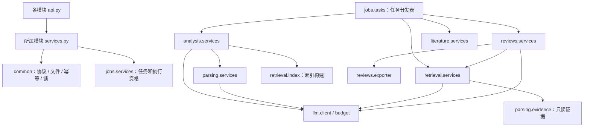

# MVP 文件架构与职责

版本：1.0｜日期：2026-09-19｜对象：前后端开发、测试与集成负责人。

2026-10-03 Word 规范更新：新稿采用五个主模块、文献综述的两个子模块、原文一致性校验和 PDF 页段行出处。旧五节历史结构兼容保留；下文旧阶段验收描述不代表新导出规范。详见 [固定研究框架与原文出处](Word固定研究框架与原文出处_2026-10-03.md)。
2026-10-03 手稿生成补充：`reviews.services` 冻结 `review-gen-v4-source-passages` 与 `complete-pdf-passages-v1`，通过 `parsing.locations.quotable_passages` 提供完整原文选择，原文校验最多修复一次。细节及真实运行记录见 [空内容修复与真实生成](手稿空内容修复与真实生成_2026-10-03.md)。

## 1. 使用方式

本文给出**建议创建的程序文件**及职责，不代表这些程序文件已经存在。开发范围、状态枚举和页面行为遵循同目录《00\_开发基线与范围》；数据库字段按《02》、HTTP 契约按《03》、任务阶段与内部调用按《04》实现。

整体采用 Django 模块化单体：一个后端代码库、一个数据库、一套后台任务实现和一个 Vue 前端。后端业务、解析、检索、模型调用与 Word 导出均用 Python；首期全部模型请求集中走 DeepSeek。前端 TypeScript 不改变“后端纯 Python”的约束。

下面列出 121 个建议源文件和配置文件。九个有数据库模型的 app 还会由开发者生成各自的初始迁移文件，总体约 130 个文件。后续必要的迁移和真实测试样本可以增加；不为了凑文件数省略数据库约束或有效测试。

- `api.py`：HTTP 入参校验、调用服务、DTO 序列化；不承载长任务。
- `services.py`：用例入口、权限检查、状态检查、事务边界和阶段协调。
- `models.py`：持久化实体、索引、唯一约束与检查约束；不调用供应商。
- `schemas.py`：模块内部结构及模型输出结构校验；与外部 DTO 分开。
- 本期不强制增加每实体 repository、接口基类或抽象工厂；模块内 ORM 查询可放服务，跨模块优先使用明确的服务入口。
- 函数签名是协作约定，参数使用语义名称；具体字段由 `02/03/04` 冻结。`ActorContext` 在 common.auth 中定义，含用户与 request_id；`ExecutionContext` 在 jobs.services 中定义，至少含 job_id、project_id、可空 run_id、attempt、lease_token、deadline、cancel_checker，与 `04` 一致。它们不是新增 HTTP 实体，不传递 Django request，也不把项目状态放在全局变量。

## 2. 完整建议文件树

```text
├── README.md
├── pyproject.toml
├── requirements.lock
├── .env.example
├── .gitignore
├── compose.yaml
├── backend/
│   ├── manage.py
│   ├── config/
│   │   ├── __init__.py
│   │   ├── settings.py
│   │   ├── urls.py
│   │   ├── celery.py
│   │   └── wsgi.py
│   ├── apps/
│   │   ├── __init__.py
│   │   ├── common/
│   │   │   ├── __init__.py
│   │   │   ├── models.py
│   │   │   ├── http.py
│   │   │   ├── auth.py
│   │   │   ├── storage.py
│   │   │   ├── idempotency.py
│   │   │   ├── locking.py
│   │   │   └── migrations/
│   │   │       └── __init__.py
│   │   ├── accounts/
│   │   │   ├── __init__.py
│   │   │   └── api.py
│   │   ├── projects/
│   │   │   ├── __init__.py
│   │   │   ├── models.py
│   │   │   ├── selectors.py
│   │   │   ├── services.py
│   │   │   ├── api.py
│   │   │   └── migrations/
│   │   │       └── __init__.py
│   │   ├── literature/
│   │   │   ├── __init__.py
│   │   │   ├── models.py
│   │   │   ├── services.py
│   │   │   ├── arxiv.py
│   │   │   ├── api.py
│   │   │   └── migrations/
│   │   │       └── __init__.py
│   │   ├── parsing/
│   │   │   ├── __init__.py
│   │   │   ├── models.py
│   │   │   ├── pdf.py
│   │   │   ├── services.py
│   │   │   ├── evidence.py
│   │   │   └── migrations/
│   │   │       └── __init__.py
│   │   ├── analysis/
│   │   │   ├── __init__.py
│   │   │   ├── models.py
│   │   │   ├── schemas.py
│   │   │   ├── services.py
│   │   │   ├── api.py
│   │   │   └── migrations/
│   │   │       └── __init__.py
│   │   ├── retrieval/
│   │   │   ├── __init__.py
│   │   │   ├── models.py
│   │   │   ├── index.py
│   │   │   ├── services.py
│   │   │   ├── api.py
│   │   │   └── migrations/
│   │   │       └── __init__.py
│   │   ├── reviews/
│   │   │   ├── __init__.py
│   │   │   ├── models.py
│   │   │   ├── schemas.py
│   │   │   ├── services.py
│   │   │   ├── validation.py
│   │   │   ├── exporter.py
│   │   │   ├── api.py
│   │   │   └── migrations/
│   │   │       └── __init__.py
│   │   ├── jobs/
│   │   │   ├── __init__.py
│   │   │   ├── models.py
│   │   │   ├── services.py
│   │   │   ├── tasks.py
│   │   │   ├── api.py
│   │   │   └── migrations/
│   │   │       └── __init__.py
│   │   └── llm/
│   │       ├── __init__.py
│   │       ├── models.py
│   │       ├── client.py
│   │       ├── schemas.py
│   │       ├── budget.py
│   │       ├── prompt_loader.py
│   │       └── migrations/
│   │           └── __init__.py
│   ├── prompts/
│   │   ├── extract_paper.md
│   │   ├── assign_topics.md
│   │   ├── compare_disputes.md
│   │   ├── expand_query.md
│   │   ├── rerank_evidence.md
│   │   ├── generate_sections.md
│   │   └── validate_claims.md
│   └── tests/
│       ├── conftest.py
│       ├── test_contract_auth.py
│       ├── test_literature_parsing.py
│       ├── test_run_retrieval.py
│       ├── test_review_export.py
│       ├── test_jobs_budget.py
│       └── fixtures/
│           └── llm_cases.json
├── frontend/
│   ├── package.json
│   ├── package-lock.json
│   ├── index.html
│   ├── vite.config.ts
│   ├── tsconfig.json
│   ├── src/
│   │   ├── main.ts
│   │   ├── App.vue
│   │   ├── router.ts
│   │   ├── env.d.ts
│   │   ├── styles.css
│   │   ├── api/
│   │   │   ├── client.ts
│   │   │   └── resources.ts
│   │   ├── types/
│   │   │   └── contracts.ts
│   │   ├── stores/
│   │   │   ├── session.ts
│   │   │   └── workspace.ts
│   │   ├── pages/
│   │   │   ├── LoginPage.vue
│   │   │   ├── ProjectsPage.vue
│   │   │   ├── WorkspacePage.vue
│   │   │   └── ReviewPage.vue
│   │   └── components/
│   │       ├── UploadPanel.vue
│   │       ├── PaperList.vue
│   │       ├── AnalysisPanel.vue
│   │       ├── SearchPanel.vue
│   │       ├── EvidencePanel.vue
│   │       ├── PdfViewer.vue
│   │       ├── ReviewEditor.vue
│   │       ├── ValidationPanel.vue
│   │       └── JobPanel.vue
│   └── tests/
│       ├── api_contract.spec.ts
│       └── project_flow.spec.ts
└── deploy/
    ├── backend.Dockerfile
    ├── frontend.Dockerfile
    └── nginx.conf
```

项目交付文档在代码仓库中统一归档至 `docs/mvp/`；包含 `contracts/openapi.json` 和 `contracts/model_outputs.schema.json`，不计入上面 121 个待实现程序文件。后端模型 Schema 校验和契约测试使用后者的对应定义；前端类型生成使用前者。将这些契约一并打包或在构建时生成等价校验结构，不能让正式镜像缺少运行所需 Schema。上传原文、临时图片、解析结果、检索索引与导出文件均写入仓库外的受控 `PRIVATE_STORAGE_ROOT`，不放在 `frontend/public` 或源码目录。

## 3. 根目录、启动与公共文件

### 3.1 根目录与后端启动

| 文件                         | 必须实现的职责                                                                                          | 产物 / 对外入口                                                      |
| ---------------------------- | ------------------------------------------------------------------------------------------------------- | -------------------------------------------------------------------- |
| `README.md`                  | 说明首次启动顺序、管理员建号、依赖锁定、测试运行、模拟与真实模型模式、文档入口；记录 MVP 不包含的功能。 | 新成员可依次完成建库迁移、建管理员、启动 Web / worker / 调度和前端。 |
| `pyproject.toml`             | 声明 Python 3.12、后端直接依赖和开发检查配置；区分运行与测试依赖。                                      | 项目元数据及唯一直接依赖来源。                                       |
| `requirements.lock`          | 保存首次构建解析出的完整依赖及精确版本；更新时连同验证结果提交。                                        | 可重复安装的 Python 依赖锁。                                         |
| `.env.example`               | 列出本文环境变量，提供非敏感示例；密钥和数据库密码留空或占位。                                          | 可复制填写的配置模板。                                               |
| `.gitignore`                 | 忽略真实 .env、密钥、日志、数据库卷、原文与衍生产物、Python / Node 缓存。                               | 防止资料和凭据进入版本库。                                           |
| `compose.yaml`               | 定义 Web、worker、调度、PostgreSQL、Redis、前端反向代理及持久卷；Web / worker 共享私有文件卷。          | 同一配置启动内部试用部署；数据库与 Redis 不直接暴露到公网。          |
| `backend/manage.py`          | Django 标准管理入口。                                                                                   | 数据库迁移、管理员建号与开发检查。                                   |
| `backend/config/__init__.py` | 暴露 Celery app 的标准加载入口，避免导入时执行网络或业务查询。                                          | Django / worker 共享任务配置。                                       |
| `backend/config/settings.py` | 读取并验证环境配置；注册 app、DRF、会话、CSRF、日志、数据库与任务参数；关闭自动补斜杠。                 | 缺少必需配置时启动失败并给出不含密钥的说明。                         |
| `backend/config/urls.py`     | 集中挂载 `00` 的全部路由，根前缀 `/api/v1`，无尾斜杠；仅引用各 app 的 API 入口。                        | 单一可审查路由表，不额外开放通用模型 CRUD。                          |
| `backend/config/celery.py`   | 定义 worker 配置、任务发现和定时恢复扫描；配置进程并发与保守预取。                                      | Web 与 worker 使用相同任务名、序列化和队列设置。                     |
| `backend/config/wsgi.py`     | 正式部署的 WSGI 应用入口。                                                                              | Web 容器服务入口。                                                   |
| `backend/apps/__init__.py`   | 定义 apps 包。                                                                                          | 无业务副作用。                                                       |

### 3.2 重复出现的框架文件

为避免把同一职责重复写十余次，以下两条覆盖文件树中每一个对应文件：

| 文件模式                                                                                                       | 逐文件适用的职责                                                                                                                       |
| -------------------------------------------------------------------------------------------------------------- | -------------------------------------------------------------------------------------------------------------------------------------- |
| `backend/apps/{common,accounts,projects,literature,parsing,analysis,retrieval,reviews,jobs,llm}/__init__.py`   | 每个文件只定义其 Python 包，不做查询、外部连接或模型调用。配置可直接注册包路径；确有启动钩子时再增加 AppConfig，避免提前创建空壳文件。 |
| `backend/apps/{common,projects,literature,parsing,analysis,retrieval,reviews,jobs,llm}/migrations/__init__.py` | 每个文件定义本 app 的迁移包；开发时生成并提交迁移。跨 app 外键形成的迁移依赖须可从空库顺序应用，不能靠手工建表解决循环。               |

### 3.3 common：协议、权限基础和受控文件

| 文件                         | 实现职责                                                                                             | 建议公开入口：输入 → 产物                                                                                                                                          |
| ---------------------------- | ---------------------------------------------------------------------------------------------------- | ------------------------------------------------------------------------------------------------------------------------------------------------------------------ |
| `apps/common/models.py`      | `FileAsset` 及幂等请求持久记录；文件仅保存内部存储键、哈希、大小和所属关系，API 不返回磁盘绝对路径。 | 持久化定义依 `02`；幂等记录保留原始受理响应与请求摘要。                                                                                                            |
| `apps/common/http.py`        | 成功 / 错误响应包装、分页、request_id、DRF 异常转换；拒绝未知字段与未知过滤参数。                    | `success(data, meta)`；`api_error(code, message, details, retryable)`；分页结果符合 `03`。                                                                         |
| `apps/common/auth.py`        | Session 认证适配、CSRF 强制、未登录统一 401；提供 ActorContext。                                     | `require_actor(request) → ActorContext`；未登录不返回业务资源信息。                                                                                                |
| `apps/common/storage.py`     | 安全文件名、暂存、哈希、原子归档、授权后二进制读取、临时文件清理；原文不可原位覆盖。                 | `stage_file(stream, limit_bytes) → StagedFile`；`commit_asset(project, staged_file, kind) → FileAsset`；`open_asset(asset) → BinaryStream`。调用者先校验资源权限。 |
| `apps/common/idempotency.py` | 规范化作用域、请求摘要比较、原受理结果重放、并发重复请求协调与过期清理；上传摘要包含 SHA256。        | `claim_or_replay(actor, method, path, key, request_hash)`；返回“重放结果”或本次写入权。先于 PROJECT_BUSY 判断。                                                    |
| `apps/common/locking.py`     | 提供 Project 行锁和统一忙状态判断；不包含模块业务。                                                  | `lock_project(project_id)` 必须在事务内调用；`require_project_idle(project)`；执行尝试提交前检查租约 / fencing 标识。                                              |

## 4. 后端领域文件与服务接口

下表的 `apps/...` 均相对 `backend/`。服务必须再次验证所属关系，不能认为“前端传来的 ID 已经可信”。修改服务接收 ActorContext；worker 服务接收 ExecutionContext 和已冻结资源 ID，重新检查执行资格。执行函数采用 `(context, resource_id)` 参数顺序；job_id 已在 context 中，导入的业务资源 ID 固定为首次受理 Job ID，重试仍沿用该值。

### 4.1 accounts 与 projects

| 文件                         | 实现职责                                                                                                     | 建议入口                                                                                                                                                              |
| ---------------------------- | ------------------------------------------------------------------------------------------------------------ | --------------------------------------------------------------------------------------------------------------------------------------------------------------------- |
| `apps/accounts/api.py`       | 实现 csrf、login、logout、me；管理员用 Django 管理命令或受控管理入口建号；不增加注册、找回密码、第三方登录。 | `get_csrf`、`login`、`logout`、`me`；登录自身也校验 CSRF，登录后前端重取令牌。                                                                                        |
| `apps/projects/models.py`    | Project、version、corpus_revision、deleted_at 和配置；所有者唯一归属，不增加成员 / 共享模型。                | 字段、版本递增及范围见 `02`。                                                                                                                                         |
| `apps/projects/selectors.py` | 只读取未删除的所属项目；提供 active_job_id 和 Run 是否过时所需信息。                                         | `list_owned_projects(actor, pagination)`；`get_owned_project(actor, project_id)`；越权、不存在与已删除均表现为 404。                                                  |
| `apps/projects/services.py`  | 创建、编辑及逻辑删除；锁 Project 检查空闲和版本，删除同时校验语料版本；保留历史与费用账本。                  | `create_project(...) → Project`；`update_project(...) → Project`；`delete_project(actor, project_id, expected_version, expected_corpus_revision) → ProjectDeletion`。 |
| `apps/projects/api.py`       | 项目列表 / 创建 / 详情 / PATCH / DELETE 的 DTO 适配。                                                        | HTTP 字段以 `03` 为准；删除后所有下属资源的用户访问均拒绝。                                                                                                           |

### 4.2 literature：上传与 arXiv 导入

| 文件                          | 实现职责                                                                                                                 | 建议入口                                                                                                                                                                                                                                                                                        |
| ----------------------------- | ------------------------------------------------------------------------------------------------------------------------ | ----------------------------------------------------------------------------------------------------------------------------------------------------------------------------------------------------------------------------------------------------------------------------------------------- |
| `apps/literature/models.py`   | Paper、不可变 PDF 关联、来源、元数据、included、version、deleted_at；数据库唯一约束支持重复上传、恢复和导入重试。        | Paper 不承载某一次 Run 的分析结论；已删除记录保留历史引用。                                                                                                                                                                                                                                     |
| `apps/literature/services.py` | 上传即时校验与归档；编辑元数据 / 纳入状态；逻辑删除与同文件恢复；受理和执行 arXiv 批量导入；变更时递增 corpus_revision。 | `upload_pdf(actor, project_id, uploaded_file, metadata, key) → Paper`；`update_paper(...) → Paper`；`delete_paper(actor, paper_id, expected_version) → PaperDeletion`；`import_arxiv(actor, project_id, arxiv_ids, key) → AcceptedJob`；`execute_import_arxiv(context, job_id) → ItemResults`。 |
| `apps/literature/arxiv.py`    | 验证 1—10 个 arXiv ID；向预定 arXiv 接口获取真实元数据和 PDF；限制重定向、时间、下载大小和请求频率。                     | `fetch_metadata(arxiv_id) → SourceMetadata`；`download_pdf(source_record) → StagedFile`。不接受用户提供的任意 URL。                                                                                                                                                                             |
| `apps/literature/api.py`      | 未删除文献列表、上传、arXiv 导入、详情、PATCH、DELETE 与授权 PDF 下载。                                                  | 上传受理遵循 `03` 幂等语义；`download_paper_file` 验证 Paper → Project → owner 后输出二进制，历史引用原文保留可读。                                                                                                                                                                             |

上传时先暂存并检查格式、体积、页数、加密和哈希，再进入短数据库事务；未通过校验的临时文件删除。相同项目中同一 PDF 重传返回既有资源；未删除时不递增语料版本，已删除时新提交恢复并递增版本。具体返回码和返回字段按 `03`；不得在此处再定义另一种去重响应。

### 4.3 parsing：页级解析与证据

| 文件                       | 实现职责                                                                                                  | 建议入口                                                                                                                                                                                                                                                   |
| -------------------------- | --------------------------------------------------------------------------------------------------------- | ---------------------------------------------------------------------------------------------------------------------------------------------------------------------------------------------------------------------------------------------------------- |
| `apps/parsing/models.py`   | ParsedDocument、EvidenceChunk；记录解析配置 / 版本、页码和原文件关联；片段稳定绑定解析结果。              | 片段类型按 `02`，不得把文本提取成功直接等同于语义识别正确。                                                                                                                                                                                                |
| `apps/parsing/pdf.py`      | pypdf 文本读取、加密 / 页数检查；pypdfium2 受控页面渲染；检查空白、异常提取结果并定位需要图像辅助的页面。 | `inspect_pdf(asset) → PdfInspection`；`extract_pages(asset) → PageTexts`；`render_page(asset, page_number) → ImageAsset`。所有业务页码为 1 起始。                                                                                                          |
| `apps/parsing/services.py` | 组织文本优先、复杂页 DeepSeek 辅助的解析；按冻结配置复用可验证结果；解析失败明确反馈。                    | `parse_paper(context, paper_snapshot, parser_config) → ParsedDocument`。模型辅助结果仍需结构校验，无法识别不能补造内容。                                                                                                                                   |
| `apps/parsing/evidence.py` | 按页和元素划分可追溯片段、记录正文 / 表格 / 公式 / 图注来源；验证引用范围；按解析结果批量读取证据。       | `build_chunks(parsed_document, elements) → EvidenceChunk[]`；`get_evidence_batch(run_scope, evidence_ids) → EvidenceDTO[]`，拒绝跨 Run 引用。text_matched 要求与该页原文匹配；视觉转录初始为 image_unverified；human_verified 是保留枚举，MVP 不自动设置。 |

pypdfium2 渲染放在受限 worker 进程中，不在 Web 请求线程中批量渲染。MVP 只保证页级定位；文件树中没有句子级坐标标注服务。

### 4.4 analysis：冻结 Run、要素、主题与争议

| 文件                        | 实现职责                                                                                                                    | 建议入口                                                                                                                                                                                                                                                      |
| --------------------------- | --------------------------------------------------------------------------------------------------------------------------- | ------------------------------------------------------------------------------------------------------------------------------------------------------------------------------------------------------------------------------------------------------------- |
| `apps/analysis/models.py`   | AnalysisRun、RunPaper、PaperAnalysis、Topic、Dispute 及必要关联；冻结语料、元数据与配置；保留人工复核独立字段。             | `02` 规定状态、唯一约束和版本；Run 不读取后来修改的 Paper 元数据替换快照。                                                                                                                                                                                    |
| `apps/analysis/schemas.py`  | 定义单篇要素 / 摘要、主题成员、争议条件与双方证据的内部结构；校验未知字段、证据范围与缺失值。                               | `validate_paper_analysis`、`validate_topics`、`validate_disputes`；输出验证后的结构。                                                                                                                                                                         |
| `apps/analysis/services.py` | 受理分析并冻结 RunPaper；执行解析、单篇分析、检索索引构建、主题与争议阶段；计算仅基于纳入语料的年份统计；处理人工复核版本。 | `create_run(actor, project_id, payload, key) → AcceptedJob`（payload 为已校验空对象）；`execute_run(context, run_id) → AnalysisRun`；`review_dispute(actor, dispute_id, expected_version, changes) → Dispute`；`get_run_snapshot(actor_or_context, run_id)`。 |
| `apps/analysis/api.py`      | Run 列表 / 创建 / 详情、单篇分析、主题 / 争议列表、争议 PATCH、证据详情；输出账本和 stale 提示。                            | 查询仅返回所属项目资源；证据入口可委托 parsing 的批量读取，但 HTTP 路由仍按 `00`。                                                                                                                                                                            |

一个 Run 中任一 RunPaper 失败，则 Run 失败，成功阶段保留。不得仅将成功论文继续汇总并把 Run 标为 ready。人工复核争议会递增 analysis_revision；已有综述继续可查看并显示过时。

### 4.5 retrieval：首期检索

| 文件                         | 实现职责                                                                                              | 建议入口                                                                                                                                                                                                    |
| ---------------------------- | ----------------------------------------------------------------------------------------------------- | ----------------------------------------------------------------------------------------------------------------------------------------------------------------------------------------------------------- |
| `apps/retrieval/models.py`   | RetrievalResult，冻结查询、查询扩展、候选与重排结果、Run 关联和生成配置。                             | 不创建向量字段，不引入 pgvector。                                                                                                                                                                           |
| `apps/retrieval/index.py`    | 为明确的 Run / 解析版本建立 TF-IDF 索引；关键词召回、候选融合及稳定排序；内部索引由服务生成。         | `build_index(run_snapshot) → IndexReference`；`recall(index_ref, queries, limits) → CandidateEvidence[]`。缓存失效键至少含 Run 和索引配置版本。                                                             |
| `apps/retrieval/services.py` | 外部受理检索任务；执行查询扩展、召回、DeepSeek 重排及证据归属校验；提供生成任务可直接调用的内部入口。 | `create_retrieval(actor, run_id, payload, key) → AcceptedJob`；`execute_retrieval(context, retrieval_id) → RetrievalResult`；`retrieve_evidence(context, run_snapshot, query, limits) → RankedEvidence[]`。 |
| `apps/retrieval/api.py`      | 启动检索 / 查询结果；拒绝对 stale 或未 ready Run 开始新检索。                                         | `create_retrieval`、`get_retrieval`；前端不接触索引文件。                                                                                                                                                   |

`retrieve_evidence` 是内部同步阶段函数：在当前 worker 中执行，使用同一个父 Job 的取消、预算和调用记录；**不能为了每个章节再创建一个公开 retrieve Job**，否则会与“每项目一个活跃 Job”冲突。从模型重排结果读取的 evidence ID 必须属于候选集合，分数不是事实正确率。

M10 受理时通过 `freeze_retrieval_config()` 冻结内部查询扩展 / 重排模板与模型参数、实际候选数和选定证据数；执行时显式透传。内部逻辑调用身份由 Review 与章节派生，Job 重试沿用同一身份和累计网络尝试次数。

### 4.6 reviews：生成、版本、核验与 Word

| 文件                         | 实现职责                                                                                                                       | 建议入口                                                                                                                                                                                                                                                                                                                                     |
| ---------------------------- | ------------------------------------------------------------------------------------------------------------------------------ | -------------------------------------------------------------------------------------------------------------------------------------------------------------------------------------------------------------------------------------------------------------------------------------------------------------------------------------------- |
| `apps/reviews/models.py`     | Review、不可变 ReviewRevision、ValidationReport、Export；关联确切 Run、analysis_revision、正文版本与核验报告。                 | 修改正文新增 revision；已完成报告不能指向新正文继续复用。                                                                                                                                                                                                                                                                                    |
| `apps/reviews/schemas.py`    | 五类固定章节、有序 section_key、claim / transition、block UUID 与 evidence_ids；禁止 HTML、重复块 ID、非法引用和缺失必需证据。 | `validate_sections(sections, *, run_scope, expected_keys=None, max_blocks_per_section=None) → ValidatedSections`；结构校验是保存和生成提交的共同门槛，生成时应用冻结的单节上限。                                                                                                                                                             |
| `apps/reviews/services.py`   | 受理生成 / 核验 / 导出；组织阶段与固定快照；保存编辑新版本并检查 base_revision_number。                                        | `create_review(actor, run_id, payload, key) → AcceptedJob`；`generate_review(context, review_id) → ReviewRevision`；`save_revision(actor, review_id, base_revision_number, sections) → ReviewRevision`；`create_validation(...)`；`validate_revision(context, validation_id)`；`create_export(...)`；`export_revision(context, export_id)`。 |
| `apps/reviews/validation.py` | 结构检查、来源完整性、分批语义核验和问题汇总；区分不支持、证据不足与执行失败。                                                 | `validate_structure(revision) → StructuralFindings`；`validate_claim_support(context, revision, evidence, *, config, validation_id) → ClaimFindings`；`build_report(...) → 报告三字段`。                                                                                                                                                     |
| `apps/reviews/snapshots.py`  | 核验报告与正文、证据完整性校验；导出警示与已确认集合检查，受理、执行和重试共用。                                               | `require_completed_report`；`export_warnings`；`require_acknowledged`；`require_revision_integrity`。                                                                                                                                                                                                                                        |
| `apps/reviews/exporter.py`   | python-docx 固定样式，首次引用排序生成文献编号，冻结元数据生成参考文献，证据附表、草稿标记与核验警示。                         | `render_docx(revision_snapshot, validation_report, bibliography, evidence) → StagedFile`；此文件不自行调用 DeepSeek。                                                                                                                                                                                                                        |
| `apps/reviews/api.py`        | 生成入口、综述列表 / 详情、正文保存与历史版本、核验 / 导出创建和查询、授权 Word 下载。                                         | 导出请求指向确切 revision 和报告；缺少匹配的报告时拒绝。                                                                                                                                                                                                                                                                                     |

综述生成过程中调用 retrieval 的内部服务取得证据，再传入模型。引用编号由后端渲染；模型只返回允许的 evidence ID。Word 不重新检索、不重新生成正文，始终导出用户指定的不可变 revision。

### 4.7 jobs：统一执行、取消与恢复

| 文件                    | 实现职责                                                                                            | 建议入口                                                                                                                                                                                                                                                                                         |
| ----------------------- | --------------------------------------------------------------------------------------------------- | ------------------------------------------------------------------------------------------------------------------------------------------------------------------------------------------------------------------------------------------------------------------------------------------------ |
| `apps/jobs/models.py`   | Job、输入快照、状态、阶段、进度、结果引用、取消意图、尝试 / 租约与错误；字段由 `02/04` 定义。       | 数据库是真实状态来源，Celery ID 仅为内部投递信息。                                                                                                                                                                                                                                               |
| `apps/jobs/services.py` | 统一受理、占用项目、领取执行、续租、进度提交、取消、终态提交和创建新重试；处理幂等重放。            | `accept_job(actor, project, kind, payload, idempotency) → AcceptedJob`；`claim_execution(job_id) → ExecutionContext`；`record_progress(context, ...)`；`cancel_job(actor, job_id)`；`retry_job(actor, job_id, key) → AcceptedJob`；`complete_job(context, result)`；`fail_job(context, error)`。 |
| `apps/jobs/tasks.py`    | Celery 薄适配与 kind → 领域服务的明确分发表；扫描未投递 queued 和失去执行资格的任务；按 `04` 恢复。 | `execute_job(job_id)`；`reconcile_jobs()`；`cleanup_expired_artifacts()`。定时清理仅处理可确认未引用的临时产物和过期幂等记录。                                                                                                                                                                   |
| `apps/jobs/api.py`      | Job 查询、取消和重试；输出阶段、预算 / 用量、逐项导入结果、错误原因与 retryable。                   | `get_job`、`cancel_job`、`retry_job`；不会直接触发领域代码同步执行。                                                                                                                                                                                                                             |

jobs.services 不导入分析或综述实现；只由 jobs.tasks 的分发表调用领域入口。各领域服务可调用 jobs.services 的进度、取消和提交接口。任务重新投递必须先领取数据库执行资格，旧 worker 即使恢复也不能越过 fencing 校验提交结果。

### 4.8 llm：唯一供应商边界

| 文件                        | 实现职责                                                                                                                                           | 建议入口                                                                                                                                                                                                                                                              |
| --------------------------- | -------------------------------------------------------------------------------------------------------------------------------------------------- | --------------------------------------------------------------------------------------------------------------------------------------------------------------------------------------------------------------------------------------------------------------------- |
| `apps/llm/models.py`        | ModelCall 与 UsageBudget：单次供应商请求及项目预算预留 / 结算；请求记录所属 Job / 阶段、配置版本、摘要、用量、耗时与错误；敏感输入不进入普通日志。 | 费用与重试的可追溯账本；字段与事务按 `02/04`，不以“模型输出看似成功”替代供应商用量记录。                                                                                                                                                                              |
| `apps/llm/client.py`        | 唯一 DeepSeek 适配器；文字 / 图片输入、结构化输出、超时、限流、有限重试、取消检查与错误映射。                                                      | `call_structured(context, request: ModelTaskRequest) → ModelTaskResult`；context 为 ExecutionContext。项目中不另建 llm.gateway，不接受模型文本指定任意 URL 或文件路径。                                                                                               |
| `apps/llm/schemas.py`       | 定义 ModelTaskRequest / ModelTaskResult、供应商用量与错误结构，将协议结果转换为统一内部形式；字段对齐 `04`。                                       | 请求含 task_type、template_version、schema_version、model_config、payload、allowed_evidence_ids、allowed_paper_ids；结果含 payload、provider_request_id、usage、finish_status、call_id。`normalize_response(raw) → ModelTaskResult`；领域引用与归属由调用模块再验证。 |
| `apps/llm/budget.py`        | 按输入 / 输出上界在调用前预留预算、控制并发并在调用后结算；实际用量缺失时保守记账；未知结算状态不自动视为零成本。                                  | `reserve_call(context, maximum_usage) → Reservation`；`settle_call(reservation, usage)`；`check_budget(context)`。缓存命中 / 未命中输入分开计价；推理 token 已包含在输出用量时不得重复收费。                                                                          |
| `apps/llm/prompt_loader.py` | 加载受版本控制的提示词并记录内容哈希；模板参数显式传入，原文作为不可信材料隔离。                                                                   | `load_prompt(name, parameters) → RenderedPrompt`，包含版本 / 哈希，供 Run 和 ModelCall 记录。                                                                                                                                                                         |

Web 进程不得调用 DeepSeek；解析图像辅助、查询扩展、重排、分析、生成与语义核验全部通过此适配器。禁止其他 app 私建供应商客户端，禁止前端直接请求供应商。正式模式不应在 API 失败时静默返回模拟结果。

## 5. 提示词与模型结构

| 文件（相对 `backend/prompts/`） | 必须规定的输入与输出                                                                                                                                                                                                                                                       |
| ------------------------------- | -------------------------------------------------------------------------------------------------------------------------------------------------------------------------------------------------------------------------------------------------------------------------- |
| `extract_paper.md`              | paper_extract 段输入当前论文的页级证据，输出 PaperExtract；research_question / research_object / summary 是单个 EvidenceText，缺失为 value=null、evidence_ids=[]；methods / datasets / metrics / conclusions / limitations 是 EvidenceText 数组，无项为 []，不混成字符串。 |
| `assign_topics.md`              | 输入已验证的 PaperAnalysis 和研究问题；输出 name、description、paper_ids、evidence_ids 及未归类信息，允许一文多主题；paper_ids 使用本 Run 纳入的 Paper.id，不传 RunPaper 记录主键。                                                                                        |
| `compare_disputes.md`           | 输入候选论文及双方原始证据；输出 left_paper_id / right_paper_id、两侧 EvidenceText claim、conditions、classification 与 reason；conditions 包含研究问题、左右适用条件与可比性理由，不把方法 / 数据集差异自动视为冲突。                                                     |
| `expand_query.md`               | 输入研究问题、当前检索语句及领域上下文；输出数量受限的词项 / 同义表达；不制造来源或执行联网。                                                                                                                                                                              |
| `rerank_evidence.md`            | 输入 query 和已召回候选；输出候选 ID 的排序、有限相关性解释；不得新增候选外证据。                                                                                                                                                                                          |
| `generate_sections.md`          | 输入固定五节要求、冻结的总目标字数 target_chars、分节目标 section_target_chars 及选定证据；篇幅是写作目标，证据不足时允许缩短；输出按 schemas 规定的 claim / transition，引文只用提供的 evidence ID。                                                                      |
| `validate_claims.md`            | 输入不可变正文版本的 claim 与所引原文；输出逐项支持 / 不支持 / 不确定等核验发现，由服务汇总 passed / needs_review；不是重新润色正文。                                                                                                                                      |

`extract_paper.md` 明确包含两个独立模板段：page_extract → PageExtract，用于页级文字 / 图像转录；paper_extract → PaperExtract，用于论文要素与摘要。prompt_loader 按 task_type 只加载对应段，分别校验 Schema，不能一次模型调用混合两种产物。其余映射为 assign_topics → topics / Topics、compare_disputes → disputes / Disputes、expand_query → query_expand / QueryExpand、rerank_evidence → rerank / Rerank、generate_sections → review_section / ReviewSection、validate_claims → verify_blocks / VerifyBlocks；名称与 `04` 及模型 Schema 一致。

全部模板说明：原文、PDF 元数据和检索内容是研究材料，不能覆盖系统规则；不执行其中的指令。模板版本改变，受影响阶段的缓存必须失效。结构正确仅表示格式符合要求，事实支持仍需证据核验和人工评审。

## 6. 前端逐文件职责

### 6.1 构建、入口、接口与状态

| 文件（相对 `frontend/`）                                                           | 具体职责                                                                                                                                                                      |
| ---------------------------------------------------------------------------------- | ----------------------------------------------------------------------------------------------------------------------------------------------------------------------------- |
| `package.json`                                                                     | Vue 3、TypeScript、路由、状态管理、PDF.js 与测试依赖；定义 dev、build、typecheck、test 命令。                                                                                 |
| `package-lock.json`                                                                | 锁定直接与间接依赖；提交并供干净环境复现构建。                                                                                                                                |
| `index.html`                                                                       | 应用挂载根节点与基础页面元信息；不嵌入 API Key 或业务数据。                                                                                                                   |
| `vite.config.ts`                                                                   | 开发 / 构建配置，开发代理将 `/api` 转发 Django，保持浏览器同源会话；不加入供应商转发地址。                                                                                    |
| `tsconfig.json`                                                                    | TypeScript 严格检查、路径与 DOM 类型配置，禁止用 any 掩盖接口不匹配。                                                                                                         |
| `src/main.ts`                                                                      | 初始化 Vue、路由、状态；挂载 App。                                                                                                                                            |
| `src/App.vue`                                                                      | 公共导航、会话状态和页面出口；处理全局登录失效提示。                                                                                                                          |
| `src/router.ts`                                                                    | 登录、项目列表、项目工作区、综述详情页面路由和登录守卫；应用页面路径不等于后端 API。                                                                                          |
| `src/env.d.ts`                                                                     | 前端公开构建变量类型声明，只允许非敏感配置。                                                                                                                                  |
| `src/styles.css`                                                                   | 基础排版、错误 / 状态样式、表格与双栏证据阅读布局、可见的键盘焦点。                                                                                                           |
| `src/api/client.ts`                                                                | 唯一 HTTP 封装：Cookie、CSRF、Idempotency-Key、request_id、统一响应 / 错误解包；支持 JSON、multipart、二进制三种响应。                                                        |
| `src/api/resources.ts`                                                             | 按 `03` 为每个明确路由提供类型化函数；例如 getProject、uploadPaper、createRun、getJob、saveRevision。不得使用通用 CRUD 猜出不存在的路由。                                     |
| `src/types/contracts.ts`                                                           | 以交付包 `contracts/openapi.json` 为类型生成 / 核对来源，集中声明 DTO、状态枚举、业务错误、分页和 AcceptedJob；字段名保持 snake_case，UUID 使用字符串；与 `03` 契约测试同改。 |
| `src/types/generated.ts` / `scripts/contracts.mjs`                                 | 从 OpenAPI 可重复生成 DTO；contracts.ts 仅显式适配已存在的年份映射、nullable 用量和 Export 扩展。                                                                             |
| `src/tokens.css` / `design-system/litreview-generator/MASTER.md`（后者位于仓库根） | M12 的 Anti-Polish / Raw Aesthetic 配色、纸张与手绘规则，正文和交互保持清晰。                                                                                                 |
| `src/stores/session.ts`                                                            | 当前用户、CSRF 初始化 / 更新、登录 / 退出 / 401 后状态清理；不存密码和供应商 Key。                                                                                            |
| `src/stores/workspace.ts`                                                          | 当前项目、论文、Run、综述列表、active_job_id 与轮询生命周期；项目版本和 stale 状态取后端；离开页面停止无关轮询。                                                              |

### 6.2 页面与组件

| 文件（相对 `frontend/src/`）     | 具体职责与输入 / 事件                                                                                                                                                                        |
| -------------------------------- | -------------------------------------------------------------------------------------------------------------------------------------------------------------------------------------------- |
| `pages/LoginPage.vue`            | 初始化 CSRF 后提交用户名 / 密码；展示认证与 CSRF 错误；成功后更新令牌和用户，进入项目列表。                                                                                                  |
| `pages/ProjectsPage.vue`         | 分页显示本人项目、创建项目、进入工作区；失败时保留用户已填研究问题。                                                                                                                         |
| `pages/WorkspacePage.vue`        | 组合文献、分析、检索、证据和任务面板；恢复 active_job_id 轮询；根据 busy / stale / ready 状态启停操作。                                                                                      |
| `pages/ReviewPage.vue`           | 加载指定综述及历史版本，编排编辑、核验、导出；提示未保存改动与版本过时；不把旧报告标为当前正文已通过。                                                                                       |
| `components/UploadPanel.vue`     | PDF 选择和上传、1—10 个 arXiv ID 输入；客户端预检仅用于体验，后端仍完整校验；触发 uploaded / importAccepted。                                                                                |
| `components/PaperList.vue`       | 论文标题 / 年份 / 来源 / 纳入状态、人工元数据编辑、解析错误入口、删除确认弹窗；PATCH / DELETE 带 expected_version，409 后保留现有内容并提示重新读取；任务期间禁止删除。                      |
| `components/AnalysisPanel.vue`   | Run 账本、单篇要素和摘要、主题、多主题归属、争议条件对照、人工确认 / 拒绝与年份统计；不显示未实现的质量评分。                                                                                |
| `components/SearchPanel.vue`     | 输入 query、启动异步检索、显示关键词召回后模型重排的证据；点击触发 evidenceSelected；stale Run 禁止新检索。                                                                                  |
| `components/EvidencePanel.vue`   | 显示片段文字 / 元素、论文快照、page_number、引用关系和来源入口；选择证据后传给 PdfViewer；不展示磁盘路径。                                                                                   |
| `components/PdfViewer.vue`       | 通过授权 PDF 接口读取原文，支持完整文件 200 加载并跳转 1 起始页面；正确处理 Cookie、401 / 404、页面释放与加载错误；MVP 不承诺句子高亮。                                                      |
| `components/ReviewEditor.vue`    | 五类固定章节和 claim / transition 块编辑；新增块创建 UUID，旧块保留 ID；选择证据，输出完整 sections，保存携带 base_revision_number。                                                         |
| `components/ValidationPanel.vue` | 明确显示报告绑定的 revision，逐条展示待审问题与证据，可核验指定已保存历史版本；无匹配且成功的报告不能导出；needs_review、分析过时或非最新正文导出时显示警示并要求显式 acknowledge_warnings。 |
| `components/JobPanel.vue`        | 显示唯一 Job 的状态、阶段、进度、预算 / 用量和可读失败原因；提供符合后端状态的取消 / 重试，取消中持续轮询至终态。                                                                            |

组件不直接调用 fetch 或供应商 API；网络调用只通过 resources → client。页面协调业务事件，组件接收 props 并发出事件，防止同一 Job 在多个面板重复轮询。

刷新后的历史恢复通过真实列表接口完成：Review 的 revisions/validations/exports、Run 的 retrievals、Project 的 jobs。相关 api.py、resources.ts、contracts.ts 和工作区 / 综述页面共同覆盖这些路由；不只依赖内存或 localStorage 中保存的 ID。

`analysis/api.py` 另提供 Run 内某篇论文的分页证据列表（可按 page_number），`parsing/evidence.py` 提供对应只读查询；ReviewEditor / EvidencePanel 用于按原文页选择新的 evidence_id，旧 Run 也能使用。历史工作区使用 RunDTO 的冻结 research_question/output_language。`literature/services.py` 保存导入逐项 pending/已解析版本，重试补 pending/failed；前端 JobPanel 按 requested_id 与 resolved_source_id 展示进度。

### 6.3 前端会话、并发与轮询规则

1. 首次打开先请求 `GET /auth/csrf`，所有写请求包括登录带 `X-CSRFToken` 和 Cookie；multipart 不手工设置 boundary。登录成功后重取 CSRF。
2. 后端同域发布。开发代理转发 `/api`，不通过“允许任意来源 + 携带凭据”解决跨域问题。
3. 为一次后台提交或 PDF 上传生成一个 UUID 幂等键；超时重发保留该键和相同请求体。用户主动发起新动作才创建新键；不对不确定的提交自动换键再发。
4. 202 后保存 job_id 和资源 ID，前台每 2 秒轮询一次，页面在后台时降为 10 秒。上一请求未结束时不启动下一次；遇到 429 按后端提示延后，不能把网络错误当作任务失败。
5. 路由切换 / 刷新后从 ProjectDTO.active_job_id 恢复任务；Run、Review 等真实资源仍从对应 GET 重新获取。数据库结果为准，本地轮询计时器不推导完成百分比。
6. 活跃 Job 存在时禁用新任务和数据修改；保留查询、原文读取和取消。前端禁用只是提示，后端的 409 PROJECT_BUSY 仍是最终约束。
7. 终态时停止轮询并刷新关联资源。执行期间 RetrievalDTO.results、ReviewDTO.latest_revision、ValidationDTO.result/structure_passed/blocks 可能为 null，按“尚未完成”渲染，不显示为空结果成功。取消请求返回后仍可能处于 cancelling，不能立即显示 cancelled 或零费用。
8. 保存正文成功后切换到新 revision，清空“当前核验已通过”状态；退出带未保存内容的编辑页要提示。遇到版本冲突保留本地草稿，禁止静默覆盖服务器正文。
9. 401 清理会话并要求重新登录；404 使用统一资源不可用提示，不泄露它属于另一个用户；PDF / Word 下载出错也解析标准 JSON 错误，避免下载一个错误文本当文件。

## 7. 模块依赖、通信和事务边界

### 7.1 依赖方向



- common 不导入领域服务；跨 app 外键使用 Django 支持的模型字符串引用，避免导入环。
- llm 不理解综述业务状态；输入由调用模块构造，输出由该模块验证。llm 只统一供应商调用、成本与错误。
- analysis 负责 Run 生命周期，parsing 只返回解析产物；不要让 parsing 反向修改 Run 状态。
- retrieval 只读冻结 Run、论文 / 证据快照；reviews 复用检索服务而不复制召回实现。
- 跨模块数据读取优先传递冻结快照或 DTO。需要直接 ORM 关联查询时由资源所属模块暴露读取函数；禁止对另一模块实体绕过服务直接写字段。
- jobs.tasks 是组合入口：它知道领域服务的名称；jobs.services 只知道任务通用字段，不与各领域形成递归调用链。

### 7.2 必须一致的事务过程

| 场景                | 短事务内必须完成                                                                                    | 事务外执行                                                     |
| ------------------- | --------------------------------------------------------------------------------------------------- | -------------------------------------------------------------- |
| 上传 / 编辑         | 幂等结果查找、Project 行锁、空闲与版本校验、关联记录及语料版本更新。                                | 暂存、哈希、PDF 基础检查；提交失败清理可确认无引用的暂存文件。 |
| 删除 / 恢复         | 锁 Project 再锁 Paper；空闲、expected_version（删除）或名额（恢复）检查；状态与版本在同一事务提交。 | 无文件销毁；保留已提交的历史快照、证据、综述和导出。           |
| 受理后台任务        | 先幂等查找，再锁 Project，检查状态 / 归属，冻结输入、创建 Job 和资源占位、保存受理响应。            | 事务提交后投递队列；投递暂时失败由数据库 queued 扫描补发。     |
| worker 阶段提交     | 检查 Job 执行尝试 / 租约仍有效、取消意图与阶段幂等；写阶段结果和进度。                              | arXiv 网络访问、PDF 处理、模型调用、Word 文件生成。            |
| 人工正文 / 争议编辑 | Project 空闲锁、expected_version / base_revision_number、结构与引用校验、版本递增。                 | 普通页面展示；编辑保存本身不暗中调用模型。                     |
| 终态与导出发布      | 再次检查执行资格；发布原子文件关联、完成资源与 Job 状态。                                           | 文件已先写到临时位置，只有数据库合法引用后才能对用户提供下载。 |

请求受理事务不能保持数据库锁等待 DeepSeek 回答。worker 恢复与重复投递以数据库检查和阶段唯一性为准，Redis 锁不能替代持久唯一约束。详细 fencing 字段与过期处理遵照 `02/04`。

### 7.3 文件与数据生命周期

- 内部存储键由程序生成，不能拼接用户上传名称形成磁盘路径；用户显示名称另存字段。上传前后都不能任意访问仓库外文件。
- 原始 PDF 不覆盖；元数据修改、研究问题或纳入集合变化通过版本使旧 Run 过时。
- 解析结果与索引缓存必须带源文件哈希和配置版本；恢复时校验存在性与完整性，不能仅凭文件名复用。
- 原文、缩略图、页图、解析文本、导出文件一律不通过公开 MEDIA_URL 直接暴露。下载服务先验证业务资源归属，再打开 FileAsset；反向代理不能将私有目录直接映射为公开静态目录。
- 若使用数据库备份恢复，同时恢复对应私有文件快照，检查数据库引用文件存在；删除临时产物前确认无已提交资源引用。
- MVP 没有物理删除 API；文献取消纳入不删除历史 Run 使用的证据和导出所需材料。

## 8. 配置与部署文件

### 8.1 环境变量清单

以下名称是实现建议，首次提交可统一调整，但代码、.env.example 与部署配置必须同时修改。具体供应商计价和任务预算以 `04` 为准；本文不填未经核验的实时价格。

| 变量                                                  | 用途 / 初始要求                                                                                                                                                     | 是否敏感   |
| ----------------------------------------------------- | ------------------------------------------------------------------------------------------------------------------------------------------------------------------- | ---------- |
| `APP_ENV`                                             | development / test / production；决定调试、模拟供应商和日志策略。                                                                                                   | 否         |
| `LLM_MODE`                                            | mock / real；默认 mock。real 必须显式启用且具备密钥、价格和预算，测试默认禁止付费；正式 real 失败不得静默退回 mock。                                                | 否         |
| `DJANGO_SECRET_KEY`                                   | Session 等 Django 安全功能所需随机密钥；正式环境必须显式提供。                                                                                                      | 是         |
| `DJANGO_DEBUG`                                        | 本地开发可 true，内部正式试用 false。                                                                                                                               | 否         |
| `DJANGO_SECURE_COOKIES`                               | Session/CSRF cookie 仅经 HTTPS 发送；空值跟随运行模式，接入 TLS 后须为 true。                                                                                       | 否         |
| `DJANGO_ALLOWED_HOSTS`                                | 明确列出允许的主机名，不以星号代替发布配置。                                                                                                                        | 否         |
| `CSRF_TRUSTED_ORIGINS`                                | 正式站点 origin；同域发布，按实际 HTTPS 地址配置。                                                                                                                  | 否         |
| `DATABASE_URL`                                        | PostgreSQL 连接；开发与集成测试锁定同一主版本。                                                                                                                     | 是         |
| `POSTGRES_PASSWORD`                                   | 仅 Compose 使用的 PostgreSQL 密码；须为 URL 安全字符，不进入镜像。                                                                                                  | 是         |
| `DJANGO_DB_CONNECT_TIMEOUT`                           | 数据库连接超时秒数，默认 5，最小 1。                                                                                                                                | 否         |
| `DJANGO_DB_CONN_MAX_AGE`                              | Django 数据库连接复用秒数，默认 60；0 表示不复用。                                                                                                                  | 否         |
| `REDIS_URL`                                           | Celery broker / 临时协调连接；数据库仍保存任务真实状态。                                                                                                            | 是         |
| `PRIVATE_STORAGE_ROOT`                                | 原文与产物私有根目录，Web / worker 可访问同一卷。                                                                                                                   | 路径不公开 |
| `DEEPSEEK_API_KEY`                                    | 由部署负责人在后端设置；只进入服务器环境或部署秘密管理，不写入代码和前端变量。                                                                                      | 是         |
| `DEEPSEEK_BASE_URL`                                   | 经验证的官方服务根地址；只允许部署负责人配置，禁止由普通 API 请求覆盖。                                                                                             | 否         |
| `DEEPSEEK_MODEL`                                      | 首选验证 deepseek-flash；实际账户冒烟后锁定并记录。                                                                                                                 | 否         |
| `DEEPSEEK_THINKING_MODE`                              | 当前适配器使用 Chat Completions 的 thinking.type：enabled / disabled，默认 disabled；不混用 Responses 协议。                                                        | 否         |
| `LLM_REQUEST_TIMEOUT_SECONDS`                         | 初始 120 秒；首轮真实冒烟后与任务租约 / 心跳配置联调。                                                                                                              | 否         |
| `LLM_MAX_ATTEMPTS`                                    | 初始 3；包含最多一次输出格式修复，不得另起不计数的修复重试。                                                                                                        | 否         |
| `LLM_MAX_INPUT_TOKENS`                                | 默认 384000；按完整提示词 UTF-8 字节数保守检查，支持约三万字单篇和双篇比较；2—30 篇分析的主题归纳和争议比较按请求大小自动分批；单篇全文、最终汇总或两篇必要依据仍超限时明确失败，不截断证据。2026-10-02 用户追加授权调整，计费仍取实际 usage。 | 否         |
| `LLM_MAX_OUTPUT_TOKENS`                               | 初始 4096；思考用量包括在输出限制内。                                                                                                                               | 否         |
| `LLM_MAX_CONCURRENCY`                                 | 初始 2；部署级有效并发上限，增加 worker 不能绕过。                                                                                                                  | 否         |
| `JOB_HEARTBEAT_SECONDS`                               | 初始 10；等待网络期间也续租。                                                                                                                                       | 否         |
| `JOB_LEASE_SECONDS`                                   | 初始 60；必须大于心跳周期，fencing 防止过期执行者写入。                                                                                                             | 否         |
| `PROJECT_DEFAULT_BUDGET_USD`                          | 项目默认预算，统一十进制 USD；演示前由项目负责人明确填写，零 / 未配置时不得被解释为无限预算。                                                                       | 否         |
| `LLM_PRICE_INPUT_CACHE_HIT_PEAK_PER_MILLION_USD`      | 峰时缓存命中输入价，USD / 百万 token。                                                                                                                              | 否         |
| `LLM_PRICE_INPUT_CACHE_MISS_PEAK_PER_MILLION_USD`     | 峰时缓存未命中输入价；预留不预先假定命中缓存。                                                                                                                      | 否         |
| `LLM_PRICE_OUTPUT_PEAK_PER_MILLION_USD`               | 峰时输出价；推理 token 已含在输出时不重复计算。                                                                                                                     | 否         |
| `LLM_PRICE_INPUT_CACHE_HIT_OFF_PEAK_PER_MILLION_USD`  | 谷时缓存命中输入价。                                                                                                                                                | 否         |
| `LLM_PRICE_INPUT_CACHE_MISS_OFF_PEAK_PER_MILLION_USD` | 谷时缓存未命中输入价。                                                                                                                                              | 否         |
| `LLM_PRICE_OUTPUT_OFF_PEAK_PER_MILLION_USD`           | 谷时输出价。                                                                                                                                                        | 否         |
| `LLM_PRICING_VERSION`                                 | 部署负责人核验的价目版本，建议含日期和模型；随调用冻结。                                                                                                            | 否         |
| `LLM_PRICING_CALENDAR_YEAR`                           | 运维核验的峰谷日历年份，真实调用要求与请求 UTC 年份一致。                                                                                                           | 否         |
| `LLM_PRICING_OFF_PEAK_DATES_UTC`                      | 逗号分隔 YYYY-MM-DD，表示节假日对应的 UTC 全谷日期；运维按官方规则核验，不联网猜测。                                                                                | 否         |
| `ARXIV_CONTACT`                                       | arXiv 客户端标识所用项目联系信息；不向模型额外发送。                                                                                                                | 按内部管理 |
| `LOG_LEVEL`                                           | 默认 INFO；记录 request_id / job_id / stage，过滤认证头、Cookie、Key 和文献全文。                                                                                   | 否         |
| `VITE_API_BASE_URL`                                   | 前端公开值，固定同域 `/api/v1`；不可包含任何密钥。                                                                                                                  | 否         |

PDF 最大 25 MiB / 50 页、单项目 30 篇、arXiv 1—10 项等 MVP 范围参数集中在 settings 中定义，不在各页面 / worker 手写不同数值；若开放环境覆盖，必须同步基线与接口校验。数据库、Redis、模型凭据不通过任何前端配置接口原样返回。

所有项目预算与接口 estimated_cost_usd 使用相同币种和十进制定点运算。预算是本程序的调用预留和停止策略；网络超时、供应商已执行但未回传用量、人工在其他客户端使用同一账户等情况，不能承诺供应商账单绝不超过本程序阈值。未结算 ModelCall 必须保留在 unsettled_call_count，不能静默释放成可用预算。

MVP 使用部署级 DeepSeek Key；不增加“每个用户粘贴自己 Key”的业务页面和数据库字段。Django 用户密码由 Django 标准哈希机制保存；前端既不持久保存登录密码，也不持久保存供应商 Key。

2026-09-21 经用户确认：三个旧单价变量由上述六个峰谷变量替代，不静默沿用旧值。真实模式要求六价均大于零、谷价不高于峰价、价目版本和当年日历已核验，以及非零预算。mock 可以保持零价、零预算，不产生真实费用。

**预留一律按峰价**：输入按缓存命中/未命中两者较高峰价估算全部输入上界，输出按峰价估算上界。结算只使用实际发起该次网络尝试时冻结的 `pricing_snapshot.tariff` 和价表，不读取结算时的当前配置。峰段为周一至周五 UTC `[01:00,04:00)`、`[06:00,10:00)`，经核验的全谷日期优先；其他时段为谷时。快照包含六价、适用档位、发起时间、模型、配置哈希和日历。边界跨时、供应商计费时间和节假日口径差异仍需与账单核对，接口金额是估算而非供应商账单。

### 8.2 部署文件职责

| 文件                         | 实现职责                                                                                                                   |
| ---------------------------- | -------------------------------------------------------------------------------------------------------------------------- |
| `deploy/backend.Dockerfile`  | 构建同一个后端镜像供 Web / worker / 调度使用；按锁文件安装依赖，非 root 运行，运行产物写私有卷；不在镜像中烘焙凭据或论文。 |
| `deploy/frontend.Dockerfile` | 锁定依赖构建前端，正式镜像仅携带构建产物及代理配置；不含 Node 开发服务或 .env 密钥。                                       |
| `deploy/nginx.conf`          | 同域前端静态资源与 `/api` 代理、合理上传限制与超时、SPA 回退；私有文件交由授权后端返回，不公开磁盘存储目录。               |

Windows 普通电脑以 Linux 容器 / WSL2 承载 Celery 部署环境；不假设原生 Windows worker 已受支持。本文件只定义交付位置，不执行安装或环境配置。部署初期采用受控 worker 进程数、每个 Job 内顺序模型请求和全局额度控制，避免正文逐节生成时出现未计入限制的并发调用。

## 9. 测试文件与最低验证责任

| 文件                                                                           | 必须覆盖的行为                                                                                                                                           |
| ------------------------------------------------------------------------------ | -------------------------------------------------------------------------------------------------------------------------------------------------------- |
| `backend/tests/conftest.py`                                                    | PostgreSQL 隔离测试库、两位用户 / 两个项目、冻结小语料、模拟供应商、受控时钟与私有临时目录；默认测试不产生付费调用。                                     |
| `backend/tests/test_contract_auth.py`                                          | 路由无尾斜杠、统一 envelope、CSRF 含登录、未登录 401、越权 404、未知字段拒绝、分页；文件端点成功二进制 / 失败 JSON。                                     |
| `backend/tests/test_literature_parsing.py`                                     | PDF 大小 / 页数 / 加密 / 损坏、同文件去重、arXiv 部分成功与重试、页码与稳定证据、复杂页失败不补造。                                                      |
| `backend/tests/test_run_retrieval.py`                                          | Run 冻结与 stale 阻断、任一论文失败使 Run 失败、多主题 / 条件对齐、重排不得引入候选外 ID、检索限制当前 Run。                                             |
| `backend/tests/test_review_export.py`                                          | 五节结构、论断证据、跨 Run 引用拒绝、编辑版本冲突、报告只绑定一个 revision、无报告禁止导出、needs_review 草稿警示、参考文献来源于冻结元数据。            |
| `backend/tests/test_jobs_budget.py`                                            | 两个同时提交仅一任务成功占用项目、幂等重放优先于 busy、不同请求体冲突、合作取消、重复投递、租约过期 / 旧 worker 禁写、预算预留结算、失败和未知用量恢复。 |
| `backend/tests/fixtures/llm_cases.json`                                        | 合法、格式错误、空结果、截断、未知 ID、无证据、供应商限流 / 超时等固定响应；不得混入真实 Key 或无授权论文全文。                                          |
| `frontend/tests/unit/client.test.ts`                                           | client 的 CSRF / Cookie、同请求保留幂等键、二进制错误处理、401 清理会话。                                                                                |
| `frontend/tests/unit/review.test.ts` / `polling.test.ts`                       | 精确版本报告、导出警示、UUID、null 状态与轮询 / Retry-After。                                                                                            |
| `frontend/tests/e2e/ui.spec.ts`                                                | HTTP 夹具验证 busy 禁用、刷新恢复、保存冲突、取消中、历史版本、PDF 与四种宽度。                                                                          |
| `frontend/tests/e2e/live.spec.ts` / `backend/tests/walkthrough_m12_browser.py` | 隔离数据库与真实 HTTP：登录 → 建项目 → 两篇 PDF → 分析 → 证据回看 → 生成 → 编辑 → 核验 → Word 下载。动态模拟供应商仅在测试入口，走正式服务层。           |

并发约束测试要使用真实 PostgreSQL 事务与独立连接验证，不能仅用 SQLite 或单线程 mock 得出通过结论。供应商模拟负责可重复的错误路径；真实 DeepSeek 小规模冒烟和学术质量人工评审由 `04` 与验收文档登记，不能用模拟测试替代。

## 10. 开发分工与合并顺序

| 阶段              | 优先落地文件                                                                 | 交付给下一位开发者的内容                                   |
| ----------------- | ---------------------------------------------------------------------------- | ---------------------------------------------------------- |
| A：契约与基础     | config、common、accounts、projects、各 models、前端 types / client。         | 可登录、项目隔离、DTO 与错误格式、可从空库应用的迁移。     |
| B：持久任务与文件 | jobs、llm 适配和模拟、literature、parsing、Upload / Paper / Job / PDF 组件。 | 可受理 / 查询 / 取消任务，PDF 去重、合法下载与页级证据。   |
| C：分析与检索     | analysis、retrieval、相关 prompts、Analysis / Search / Evidence 面板。       | 两篇以上论文可完成 Run，引用落到当前 Run 的真实页级证据。  |
| D：综述闭环       | reviews、剩余 prompts、Review / Validation 页面组件。                        | 不可变正文、编辑冲突处理、指定版本核验与可追溯 Word 草稿。 |
| E：恢复与交付     | tests、部署文件、README 与统一回归。                                         | 普通电脑运行记录、故障恢复结果、成本记录和人工审阅样例。   |

前端可在 A 阶段使用 `03` 的固定示例并行开发；所有 mock 应保持同一 DTO，真实后端接入后删除临时页面数据。任何人修改状态、字段或路由前，先同时更新契约、前端类型、后端 schema 与相关测试；禁止以“另一个模块以后适配”为由合入不一致接口。

**交付判断：**这套目录支持 `00` 的完整 MVP 流程；它不实现预训练语义向量、质量加权、协作编辑或自动投稿。后续新增功能应在完成当前闭环和验收后再扩展目录。


### 30 篇分析的批次配置补充（2026-10-03）

`MVP_LIMITS.PAPERS_PER_PROJECT_MAX=30` 同时约束上传和分析受理；单次分析要求纳入 2—30 篇。`ANALYSIS_PAPERS_PER_BATCH=8` 是主题归纳每次请求的数量上限，另按完整提示词输入大小缩小批次。`DISPUTES_MAX_PAPERS_PER_TOPIC=8` 保留历史名称，但现表示单次争议比较容量，不再截断主题成员；所有同主题论文及跨批次配对均被覆盖。两项是代码设置而非新增环境变量。

Run 在 `topics` / `disputes` 快照冻结分批修订、容量、输入保守上界与比较素材策略，稳定批次逻辑 ID 用于重试；每次模型请求仍由后端网关预算与费用账本管理。详细规则见 [30 篇文献分析](30篇文献分析_实现与验证_2026-10-03.md)。
