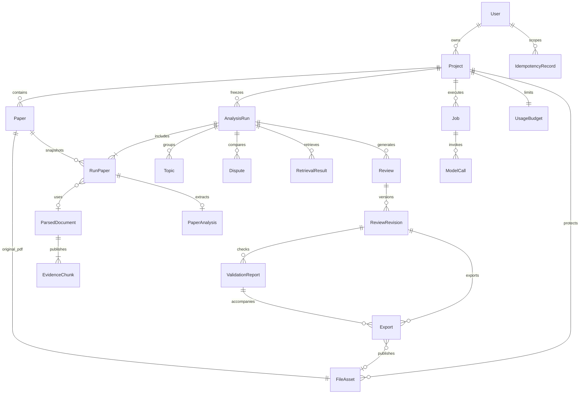

# 数据模型与一致性

版本：1.0｜日期：2026-09-19。本文是数据库与持久化设计，不是已经实现的模型或迁移。范围遵循 [00](00_开发基线与范围.md)，公开字段遵循 [03](03_HTTP接口契约.md)，执行协议遵循 [04](04_后台流程与DeepSeek规范.md)。

## 1. 类型、共有字段和归属

使用 PostgreSQL；业务表的 `id` 均为 UUID，默认由服务端生成。所有表都有必填 `created_at`，默认服务端当前 UTC；可变表另有 `updated_at`，默认同 created_at、修改时更新。下表不重复这些共有字段。JSONB 默认数组 / 对象必须每行独立创建，不共享可变默认对象。

表格“必填”指持久化是否允许 null；“—”表示无默认、必须由服务层明确提供。外键统一 `PROTECT`；MVP 不提供物理删除接口。标记“计算”的字段不建列。所有对外时间为 UTC ISO 8601，外键输出 UUID 字符串，十进制金额输出字符串。

| 模块                       | 模型                                                               |
| -------------------------- | ------------------------------------------------------------------ |
| Django 内置认证 / accounts | 使用内置 User，不另建用户表；对外 id 转字符串，绝不假设为 UUID     |
| common                     | FileAsset、IdempotencyRecord                                       |
| projects / literature      | Project / Paper                                                    |
| parsing                    | ParsedDocument、EvidenceChunk                                      |
| analysis                   | AnalysisRun、RunPaper、PaperAnalysis、Topic、Dispute               |
| retrieval / reviews        | RetrievalResult / Review、ReviewRevision、ValidationReport、Export |
| jobs / llm                 | Job / ModelCall、UsageBudget                                       |

ER 图省略部分归属外键。所有含 project_id 的记录必须与其父记录项目一致；不能只依靠 UUID 不可猜测保证权限。JSON 内 UUID 不具备数据库外键能力，写入时必须做集合与关系校验。

## 2. 项目、文献和文件

### 2.1 Project

| 字段                         | 类型                    | 必填 / 默认 | 约束或说明                                                         |
| ---------------------------- | ----------------------- | ----------- | ------------------------------------------------------------------ |
| owner                        | FK User                 | 是 / —      | 所有权限的根；请求用户不能指定其他 owner                           |
| title                        | varchar(120)            | 是 / —      | 1—120 字符                                                         |
| research_question            | text                    | 是 / —      | 5—2,000 字符                                                       |
| output_language              | varchar                 | 是 / zh-CN  | MVP 仅 zh-CN                                                       |
| version、corpus_revision     | positive bigint，各一列 | 是 / 各 1   | 分别为项目编辑版本与语料版本                                       |
| deleted_at                   | timestamptz             | 否 / null   | 非空表示逻辑删除；隐藏整个项目及其下属资源的用户访问，保留底层数据 |
| latest_run_id、active_job_id | 计算                    | 可空        | 分别查询最近创建 Run、唯一活跃 Job；不维护重复指针                 |

索引：`(owner_id, created_at DESC, id DESC)`。修改 title 只增加 version；修改研究问题同时增加 corpus_revision。论文内容相关变更只增加 corpus_revision，不假装是项目表单编辑。

项目删除在 Project 行锁内检查空闲、expected_version 和 expected_corpus_revision，设置 deleted_at 并递增 version。重复删除不再递增；不递增 corpus_revision、不逐个修改 Paper / Run / Review，也不删除 FileAsset 或费用账本。所有用户读取与写入均排除所属项目 deleted_at 非空的记录；内部费用结算仍可锁定保留的项目。没有用户恢复接口。

### 2.2 Paper

| 字段                          | 类型                           | 必填 / 默认                       | 约束或说明                                                        |
| ----------------------------- | ------------------------------ | --------------------------------- | ----------------------------------------------------------------- |
| project、file_asset           | FK Project、OneToOne FileAsset | 是 / —                            | file_asset 为此 Paper 不可变原始 PDF                              |
| title                         | varchar(500)                   | 是 / —                            | 上传缺省使用文件名；模型不得自动覆盖                              |
| authors、year                 | JSONB string[]、smallint       | 是 / []；否 / null                | 作者顺序保留；year 为 1000—当前年份                               |
| source、source_id、source_url | varchar、varchar、text         | 是 / upload；否 / null；否 / null | source=upload/arxiv；arxiv 保存已解析的具体版本 ID 和可信来源 URL |
| included、version             | boolean、positive bigint       | 是 / true；是 / 1                 | metadata 或 included 实际变化时递增 version                       |
| deleted_at                    | timestamptz                    | 否 / null                         | 非空时从当前账本移除且 included=false；删除 / 恢复递增 version    |
| file_sha256                   | char(64)                       | 是 / —                            | 与 FileAsset.sha256 相同，创建后不可改；用于项目内唯一约束        |
| page_count                    | smallint                       | 是 / —                            | 上传 / 导入时真实检查，1—50                                       |

唯一：`(project_id, file_sha256)`；非空 arxiv source_id 唯一 `(project_id, source, source_id)`，已删除记录仍参与唯一约束。索引：`(project_id, created_at DESC, id DESC)`、`(project_id, included)`、`(project_id, deleted_at)`。数据库检查 `deleted_at IS NULL OR included=false`。同哈希重复上传返回已有 Paper：未删除时不能改其 included 或元数据；已删除时以新的上传请求恢复，保留 ID、元数据和原始文件，设 included=true。每项目最多 30 条未删除记录，包括取消纳入项，在 Project 行锁内计数检查；恢复也检查名额。

Paper DTO 的 file_size/original_filename 来自 FileAsset；file_url 由授权路由构造。PDF 不可原位替换；新文件形成新 Paper。新增 Paper、metadata/included 的实际变化、删除和恢复递增 Project.corpus_revision；未删除文件的重复上传、重复删除与无变化保存不递增。列表及新 Run 排除 deleted_at 非空的论文；历史 RunPaper、证据、综述和导出保持原样，授权原文仍可读。编辑 / 删除统一按 Project → Paper 加行锁，忙碌时拒绝；已删除记录不可 PATCH。

### 2.3 FileAsset

| 字段                | 类型             | 必填 / 默认 | 约束或说明                                                        |
| ------------------- | ---------------- | ----------- | ----------------------------------------------------------------- |
| project             | FK Project       | 是 / —      | PDF、页图、解析 JSON、索引、模型原始业务输出、DOCX 都须有项目归属 |
| storage_key         | varchar          | 是 / —      | 服务端生成的相对存储键，全局唯一，不允许客户端指定                |
| purpose、media_type | varchar、varchar | 是 / —      | 内部用途标识与实际 MIME；用途不是外部任务状态                     |
| original_filename   | varchar          | 是 / —      | 仅显示；去掉路径片段与控制字符                                    |
| sha256、size_bytes  | char(64)、bigint | 是 / —      | 发布前计算；size_bytes ≥ 0                                        |
| source_job          | FK Job           | 否 / null   | 同步上传为空，后台产物记录创建者                                  |

只登记已完整关闭且可读取的文件，不额外维护 pending 状态。工作临时文件不注册可下载的 FileAsset。storage_key 解析后必须仍在受控根目录下；文件目录不暴露公共静态 URL。由 Paper / Export / Run 的授权上下文读取，禁止按任意 FileAsset ID 直接下载模型原始输出。

## 3. 分析快照和证据

### 3.1 AnalysisRun 与 RunPaper

| 模型.字段                                      | 类型                                   | 必填 / 默认                     | 约束或说明                                             |
| ---------------------------------------------- | -------------------------------------- | ------------------------------- | ------------------------------------------------------ |
| AnalysisRun.project                            | FK Project                             | 是 / —                          | 根归属                                                 |
| AnalysisRun.status                             | varchar                                | 是 / processing                 | processing/ready/failed/cancelled                      |
| AnalysisRun.corpus_revision、analysis_revision | positive bigint，各一列                | 是 / 冻结当前值；是 / 1         | 语料版本不可改；人工争议复核递增 analysis_revision     |
| AnalysisRun.research_question、output_language | text、varchar                          | 是 / 创建时复制                 | 后续 Project 改字不改变此快照                          |
| AnalysisRun.config_snapshot                    | JSONB object                           | 是 / —                          | 模型/解析器/模板/schema/检索配置和依赖锁摘要；不含密钥 |
| AnalysisRun.index_asset、index_manifest        | FK FileAsset、JSONB object             | 否 / null；否 / null            | 完整索引发布后一次性填写                               |
| AnalysisRun.error                              | JSONB object                           | 否 / null                       | 当前尝试最终业务错误；历史错误保留在旧 Job             |
| RunPaper.run、paper                            | FK AnalysisRun、FK Paper               | 是 / —                          | `(run_id,paper_id)` 唯一                               |
| RunPaper.title、authors、year                  | varchar(500)、JSONB string[]、smallint | 是 / 快照；是 / 快照；否 / null | 从 Paper 冻结，不跟随原论文编辑                        |
| RunPaper.source、source_id、source_url         | varchar、varchar、text                 | 是 / 快照；否 / null；否 / null | 参考文献来源冻结                                       |
| RunPaper.file_asset、file_sha256、page_count   | FK FileAsset、char(64)、smallint       | 是 / 快照                       | 与纳入时 PDF 完全一致                                  |
| RunPaper.status                                | varchar                                | 是 / pending                    | pending/processing/ready/failed                        |
| RunPaper.parsed_document、error                | FK ParsedDocument、JSONB object        | 否 / null；否 / null            | 完整解析成功后填 FK；失败有错误                        |

索引：Run `(project_id, created_at DESC, id DESC)`；RunPaper `(run_id,status)`。Run.is_stale 为 corpus_revision 与 Project 当前值比较；job_id 查询最近尝试，不存重复任务状态。papers/stats 由 RunPaper 快照计算；year_counts、unknown_year_count 不读取当前 Paper 年份。Run 创建后纳入集合固定；失败排除论文须新建 Run。

### 3.2 ParsedDocument 与 EvidenceChunk

| 模型.字段                                                        | 类型                            | 必填 / 默认               | 约束或说明                                                                   |
| ---------------------------------------------------------------- | ------------------------------- | ------------------------- | ---------------------------------------------------------------------------- |
| ParsedDocument.project、paper、source_file                       | FK Project、Paper、FileAsset    | 是 / —                    | 必须指向相同项目、文件                                                       |
| ParsedDocument.parser_revision、config_hash、source_sha256       | varchar、char(64)、char(64)     | 是 / —                    | 共同确定解析缓存版本                                                         |
| ParsedDocument.page_count、content_hash                          | smallint、char(64)              | 是 / —                    | 完成全部页后确认                                                             |
| ParsedDocument.raw_pages_asset、structured_asset                 | FK FileAsset，各一列            | 是 / —                    | 原始按页文本及结构化完整产物；图像页另在结构化产物内关联页图资产             |
| EvidenceChunk.parsed_document                                    | FK ParsedDocument               | 是 / —                    | 不可变归属；ID 不能移到其他解析产物                                          |
| EvidenceChunk.ordinal、page_number                               | integer、smallint               | 是 / —                    | ordinal 从 1 起，page_number 为真实 1 起始页码                               |
| EvidenceChunk.element_type、section                              | varchar、text                   | 是 / —；否 / null         | text/table/formula/figure_caption；未知章节为 null                           |
| EvidenceChunk.text、original_text                                | text、text                      | 是 / —；否 / null         | text 是提供模型/检索的文本；原始抽取文本独立保留，图像转录不能伪称原文已匹配 |
| EvidenceChunk.locator、verification                              | JSONB object、varchar           | 是 / —                    | locator 见下文；text_matched/image_unverified/human_verified                 |
| EvidenceChunk.source_image、normalization_revision、content_hash | FK FileAsset、varchar、char(64) | 否 / null；是 / —；是 / — | 图像页绑定实际渲染资产，归一化规则可追溯                                     |

ParsedDocument 唯一 `(project_id, source_sha256, parser_revision, config_hash)`，只有完整成功产物可登记/复用。Chunk 唯一 `(parsed_document_id, ordinal)`，索引 `(parsed_document_id,page_number)`。文本证据校验针对同页 original_text / raw_pages，不能针对模型改写互相自证。

locator 为 `{granularity:"page"|"region",bbox:null|[x0,y0,x1,y1]}`；坐标为左上原点、0—1 归一化，满足 x0<x1、y0<y1；page 粒度 bbox=null。MVP 默认页级。human_verified 只是保留枚举，本期没有修改证据认证状态的 HTTP 接口，不得自动设置。

EvidenceDTO 的 run_id/paper_id 通过请求 Run 与 RunPaper→ParsedDocument 关系查得；Chunk 本身无需重复 run_id。跨 Run 可复用同一完整解析产物，但必须先验证该 Run 实际纳入它。旧证据不重新指向新版文本。

### 3.3 PaperAnalysis、Topic、Dispute

| 模型.字段                                   | 类型                               | 必填 / 默认                     | 约束或说明                                                                           |
| ------------------------------------------- | ---------------------------------- | ------------------------------- | ------------------------------------------------------------------------------------ |
| PaperAnalysis.run_paper                     | OneToOne RunPaper                  | 是 / —                          | 每篇每 Run 仅一个完整分析                                                            |
| PaperAnalysis.payload、generation_snapshot  | JSONB object，各一列               | 是 / —                          | 下述要素与摘要；生成时模型/模板/schema/证据哈希                                      |
| PaperAnalysis.model_call_ids                | JSONB UUID[]                       | 是 / []                         | 关联已成功完整调用，服务层验证本项目与 Job                                           |
| Topic.run、name、description                | FK AnalysisRun、varchar(200)、text | 是 / —                          | description 可空串，不能用模型补造事实                                               |
| Topic.paper_ids、evidence_ids               | JSONB UUID[]，各一列               | 是 / —                          | 不重复；成员至少 1 篇，全部属于 Run；证据属于成员文献                                |
| Dispute.run、left_paper、right_paper        | FK AnalysisRun、Paper、Paper       | 是 / —                          | 左右不同，均在当前 Run                                                               |
| Dispute.left_claim、right_claim、conditions | JSONB object，各一列               | 是 / —                          | 字段结构如下；两侧证据分别属于对应论文                                               |
| Dispute.classification、reason              | varchar、text                      | 是 / —                          | possible_conflict/different_conditions/complementary/insufficient_evidence；自动解释 |
| Dispute.review_status、review_note、version | varchar、text、positive bigint     | 是 / pending；是 / 空串；是 / 1 | pending/confirmed/rejected；rejected 必填非空说明                                    |
| Dispute.reviewed_by、reviewed_at            | FK User、timestamptz               | 否 / null；否 / null            | 人工复核审计；用户 ID 不转换为 UUID                                                  |

EvidenceText 统一为 `{value:string|null,evidence_ids:UUID[]}`：缺失 value=null、evidence_ids=[]；有事实 value 时至少一个合法证据。PaperAnalysis.payload 必含 research_question、research_object、summary 三个 EvidenceText，以及 methods/datasets/metrics/conclusions/limitations 五个 EvidenceText 数组；缺失数组为 []。单篇分析全部证据必须来自同一 RunPaper。HTTP 将 payload 展平为 DTO，id/run_id/paper_id 从关系补齐。

Dispute.conditions 为 `{research_question:string,left_conditions:string,right_conditions:string,comparability_reason:string}`，四项均必填；条件无记录时明确“原文未报告”，不能猜测。left_claim/right_claim 为 EvidenceText；条件陈述由各自 claim 的 evidence_ids 支撑。无法找到两侧有效证据不能确认为冲突。自动 classification/reason/claims 不可被人工 PATCH 覆盖；人工字段独立保存。

Topic、Dispute 索引 `(run_id,created_at,id)`；Dispute 增加 `(run_id,review_status)` 与数据库左右 paper 不同约束。主题多重归属合法；争议不设置“每论文对只有一条”的唯一约束，因为一对论文可以在不同论断上有不同结果。阶段批次完成后事务替换本次未发布产物，避免重试累加重复候选。

## 4. 检索、正文、核验和导出

### 4.1 RetrievalResult 与 Review

| 模型.字段                                                 | 类型                                | 必填 / 默认                             | 约束或说明                                           |
| --------------------------------------------------------- | ----------------------------------- | --------------------------------------- | ---------------------------------------------------- |
| RetrievalResult.run、query                                | FK AnalysisRun、text                | 是 / —                                  | query 2—2,000 字符                                   |
| RetrievalResult.analysis_revision、candidate_limit、top_k | positive bigint、smallint、smallint | 是 / 当前快照；是 / 20；是 / 5          | limit 5—50，top_k 1—10 且 ≤ limit                    |
| RetrievalResult.config_snapshot                           | JSONB object                        | 是 / —                                  | 索引版本、扩展/重排模板和模型配置                    |
| RetrievalResult.expanded_queries、candidates、results     | JSONB，各一列                       | 否 / null                               | 完成前 null；成功一次性发布，成功但无证据 results=[] |
| Review.project、run                                       | FK Project、AnalysisRun             | 是 / —                                  | 必须同项目                                           |
| Review.title                                              | varchar(120)                        | 是 / —                                  | 缺省由服务端研究项目名称构造并控制长度               |
| Review.analysis_revision、target_chars、style             | positive bigint、smallint、varchar  | 是 / 当前快照；是 / 3000；是 / standard | 长度 2000—4000；只有 standard                        |
| Review.config_snapshot                                    | JSONB object                        | 是 / —                                  | 创建即冻结生成参数；不随环境配置变更                 |

检索 candidates 内部保存 `{evidence_id,recall_score,matched_queries}`，expanded_queries 为 string[]；公开 results 为 `[{evidence_id,rank,score,reason}]`，rank 从 1 连续起，score∈[0,1] 仅排序分，不是正确概率。结果 ID 去重并限于候选和 Run。索引 `(run_id,created_at DESC,id DESC)`。

Review 索引 `(project_id,created_at DESC,id DESC)`。首次受理只创建 Review，没有空白 revision 0；完整生成后提交 revision 1。latest_revision 计算最高版本，首次生成未完成为 null。job_id 来自最近对应 Job，不给 Review/RetrievalResult 再加一套执行状态。

### 4.2 ReviewRevision

| 字段                                                | 类型                      | 必填 / 默认               | 约束或说明                                                                          |
| --------------------------------------------------- | ------------------------- | ------------------------- | ----------------------------------------------------------------------------------- |
| review、run                                         | FK Review、AnalysisRun    | 是 / —                    | run 与 Review 一致，固定证据范围                                                    |
| revision_number、analysis_revision、corpus_revision | positive bigint，各一列   | 是 / —                    | revision_number 从 1 连续；其他值冻结来源                                           |
| sections、config_snapshot                           | JSONB array、JSONB object | 是 / —                    | 固定框架正文与生成来源配置，不可原位更新                                                |
| source、created_by、source_job                      | varchar、FK User、FK Job  | 是 / —；是 / —；否 / null | source=generated/manual；created_by 始终为发起操作的用户，generated 另有 source_job |
| base_revision                                       | FK ReviewRevision         | 否 / null                 | revision 1 为 null；手工新版本指向保存时最新版本                                    |
| content_hash                                        | char(64)                  | 是 / —                    | 对规范化 sections 计算；用于核验与导出完整性检查                                    |

唯一 `(review_id,revision_number)`；source_job 非空时唯一，阻止同一生成任务重复提交。新 `sections` 固定六个依序内容槽：background/significance/approach/theoretical_basis/research_status/achievements；中间两个是“文献综述”的子模块，其余四个为主模块。每槽 `{section_key,title,blocks}`，每块 `{block_id,kind,text,evidence_ids}`，block_id 全文唯一。claim 每块恰好引用一条本 Run 的可定位 PDF 证据，正文须为完整原句或原段；transition 只允许独立的“提供的素材中没有该内容。”。全稿 ≤100 block，每块 1—600 字符，禁止 HTML。原文编号保留，`config_snapshot.source_citations` 保存 PDF 文件名及页段行位置。旧五节历史结构仍可读取和编辑，新 Word 导出须重新生成。

人工保存锁 Project 与 Review，base_revision_number 必须等于最高版本；先验证完整正文，再插入 N+1。新版本继承 base_revision 的 analysis_revision，不能因改字消除分析过时状态。引用顺序、文献编号只在渲染时派生。

### 4.3 ValidationReport 与 Export

| 模型.字段                                         | 类型                                | 必填 / 默认          | 约束或说明                                               |
| ------------------------------------------------- | ----------------------------------- | -------------------- | -------------------------------------------------------- |
| ValidationReport.revision                         | FK ReviewRevision                   | 是 / —               | 唯一受检正文，不可换绑                                   |
| ValidationReport.content_hash、config_snapshot    | char(64)、JSONB object              | 是 / —               | 受理时冻结正文哈希及核验规则/模型配置                    |
| ValidationReport.result、structure_passed、blocks | varchar、boolean、JSONB array       | 否 / null，各一列    | pending 只由 Job 表示；完成后 result=passed/needs_review |
| Export.revision、validation_report                | FK ReviewRevision、ValidationReport | 是 / —               | 两者必须是同一版本；API 字段为 validation_id             |
| Export.status                                     | varchar                             | 是 / pending         | pending/ready/failed/cancelled                           |
| Export.acknowledge_warnings、warnings             | boolean、JSONB string[]             | 是 / false；是 / []  | 受理时冻结过时、历史版本与核验问题警示                   |
| Export.content_hash、template_revision            | char(64)、varchar                   | 是 / —               | 固定正文和 Word 模板版本                                 |
| Export.file_asset、error                          | FK FileAsset、JSONB object          | 否 / null；否 / null | ready 时必须有完整 DOCX；失败有原因                      |

Validation blocks 为 `[{block_id,structure_ok,support,issues,suggestion}]`，其中 support=supported/unsupported/uncertain/not_applicable，issues 为 string[]，suggestion 为 string|null。成功报告覆盖正文所有 block 恰好一次。任一结构错误或 unsupported/uncertain 均为 needs_review；结构错误禁止导出。后台调用失败保持结果三字段为 null，不伪装成已完成核验。

索引 Validation `(revision_id,created_at DESC,id DESC)`、Export `(revision_id,created_at DESC,id DESC)`。允许同版本多次核验与多次独立导出；不能对 revision_id 加一对一约束。已完成报告与 ready 文件不可改写，重试失败记录沿用同资源，但使用新 Job。所有导出是草稿；无需新增审批实体或 approved 状态。

## 5. 任务、幂等和费用

### 5.1 Job

| 字段                                         | 类型                             | 必填 / 默认                                              | 约束或说明                                         |
| -------------------------------------------- | -------------------------------- | -------------------------------------------------------- | -------------------------------------------------- |
| project、requested_by                        | FK Project、User                 | 是 / —                                                   | requested_by 必须为项目 owner                      |
| kind、status                                 | varchar，各一列                  | 是 / —；是 / queued                                      | kind 与状态严格使用 00 枚举                        |
| resource_type、resource_id                   | varchar、UUID                    | 是 / —                                                   | 见下文对象映射；不得接收客户端任意对象类型         |
| frozen_input、input_hash                     | JSONB object、char(64)           | 是 / —                                                   | 固定业务输入、版本与配置；重试复用                 |
| stage、progress                              | varchar、JSONB object            | 是 / accepted；是 / {completed:0,total:null,unit:"step"} | stage 依 04 阶段名；不是额外生命周期               |
| result、error                                | JSONB，各一列                    | 否 / null                                                | 结果 / 标准错误；arxiv 部分成功失败也有逐项 result |
| retry_of_job、attempt                        | FK Job、positive integer         | 否 / null；是 / 1                                        | 新 Job 链接原尝试，原历史不改写                    |
| lease_token、lease_expires_at、heartbeat_at  | bigint、timestamptz、timestamptz | 是 / 0；否 / null；否 / null                             | token 单调递增 fencing；非客户端字段               |
| cancel_requested_at、started_at、finished_at | timestamptz，各一列              | 否 / null                                                | 真实事件时间                                       |
| dispatch_attempts、last_dispatched_at        | integer、timestamptz             | 是 / 0；否 / null                                        | 可靠补投信息；不以队列 ACK 推导成功                |

数据库必须有部分唯一约束：每 project 仅一条 status∈queued/running/cancelling。索引 `(project_id,created_at DESC,id DESC)`、`(status,lease_expires_at)`、`(resource_type,resource_id,created_at DESC,id DESC)`、`(status,last_dispatched_at)`。

kind→resource_type：analyze→analysis_run；retrieve→retrieval_result；generate_review→review；validate_review→validation_report；export_docx→export；import_arxiv→import_batch。导入的 resource_id 固定为首次受理的 Job.id，后续重试的 Job.id 改变，但 resource_id 沿用原值；按该固定 ID 汇集同批次历史。resource_id 为内部限定多态关联，数据库不能直接建一个跨表 FK：只能由统一 accept_job 服务分发校验目标存在、项目归属和类型，事务内创建资源与 Job；不提供任意多态写入。取消/查询和同键重放以外的互斥写入先锁 Project 行。

资源上的 job_id 计算最近尝试；Job 是执行状态唯一来源。Run.status/RunPaper.status 是分析可用性，Export.status 是文件可用性，二者必要映射在终态事务中一起提交，不由前端或独立定时任务猜测更新。Review/RetrievalResult/ValidationReport 不再另建 job_status。Job.usage 聚合 ModelCall 账本而非多处累加。

### 5.2 IdempotencyRecord

| 字段                                             | 类型                                 | 必填 / 默认          | 约束或说明                                                |
| ------------------------------------------------ | ------------------------------------ | -------------------- | --------------------------------------------------------- |
| user、method、canonical_path、key                | FK User、varchar、text、UUID         | 是 / —               | 组合唯一 `(user_id,method,canonical_path,key)`            |
| request_hash                                     | char(64)                             | 是 / —               | 规范化 JSON；上传另含实际文件 SHA256 与元数据             |
| response_status、response_body、response_headers | smallint、JSONB object、JSONB object | 是 / —               | 只存成功受理/创建响应及必要安全响应头，不存 Cookie 或密钥 |
| project、job                                     | FK Project、Job                      | 否 / null；否 / null | 上传有 project 无 job；异步有两者                         |
| expires_at                                       | timestamptz                          | 是 / 创建至少 7 天后 | 活跃 Job 的记录不可过期清理                               |

索引 expires_at。幂等记录和业务资源、Job 在同一数据库事务提交，无成功记录先于实际资源。权限校验后、PROJECT_BUSY 之前查同键；不同请求哈希 409，同请求直接返回原状态码和资源，即使 Job 已完成也不再发任务。并发首次请求由唯一约束与事务锁收敛，冲突后读取已提交记录，不换 key 自动重试。

### 5.3 ModelCall 与 UsageBudget

| 模型.字段                                                                  | 类型                       | 必填 / 默认                   | 约束或说明                                                                              |
| -------------------------------------------------------------------------- | -------------------------- | ----------------------------- | --------------------------------------------------------------------------------------- |
| UsageBudget.project                                                        | OneToOne Project           | 是 / —                        | 只做项目级预算，不新增用户/团队额度模型                                                 |
| UsageBudget.limit_usd、settled_usd、reserved_usd                           | numeric(18,8)，各一列      | 是 / 管理配置；是 / 0；是 / 0 | 非负，金额使用 Decimal；reserved 含未决调用                                             |
| ModelCall.project、job                                                     | FK Project、Job            | 是 / —                        | 与有效执行上下文一致                                                                    |
| ModelCall.task_type、logical_call_id、network_attempt                      | varchar、UUID、smallint    | 是 / —                        | 单逻辑调用最多 3 次网络尝试，含最多一次格式修复                                         |
| ModelCall.lease_token、request_hash、cache_key                             | bigint、char(64)、char(64) | 是 / —                        | 固定发起者；缓存 key 含项目、版本、模型和思考参数                                       |
| ModelCall.model_snapshot、pricing_snapshot                                 | JSONB object，各一列       | 是 / —                        | 模型、模板/schema、参数及 USD 单价、计价配置版本                                        |
| ModelCall.provider_request_id、raw_output_asset                            | varchar、FK FileAsset      | 否 / null；否 / null          | 不将原始输出默认暴露给前端                                                              |
| ModelCall.outcome                                                          | varchar                    | 是 / reserved                 | 内部调用账本枚举 reserved/in_flight/succeeded/failed/unsettled/cancelled；不是 Job 状态 |
| ModelCall.reserved_usd、estimated_cost_usd                                 | numeric(18,8)，各一列      | 是 / —；否 / null             | 请求前预留；未知费用保留 null 并保留预留                                                |
| ModelCall.input_tokens、output_tokens、cache_hit_tokens、cache_miss_tokens | bigint，各一列             | 否 / null                     | 供应商未知用量不写 0；推理 token 包含于 output，不重复累计                              |
| ModelCall.started_at、finished_at、settled_at                              | timestamptz，各一列        | 否 / null                     | 结算成功后不能重复扣账                                                                  |
| ModelCall.slot_expires_at                                                  | timestamptz，索引          | 否 / null                     | 全局并发名额有效期；已确认请求结束可释放，未知在途请求保留至安全窗口                    |
| ModelCall.error、usage_raw                                                 | JSONB object，各一列       | 否 / null                     | 脱敏失败摘要与供应商 usage 原始计数                                                     |

ModelCall 唯一 `(logical_call_id,network_attempt)`，索引 `(job_id,created_at)`、`(project_id,outcome)`、`cache_key`。缓存不把 cache_key 设为全表唯一，因为失败与重新调用需保留多个账本；只复用完整成功且键一致结果，引用原 call_id，不重复计费。模型业务结果 Schema 失败但供应商已完成收费仍须结算，不得因应用失败释放已花费用。

预算限额从管理员部署配置复制到项目 UsageBudget，不在 Project HTTP 输入开放。部署级最大并发、单调用上限、单价与允许真实调用开关仅是部署配置，不引入账户级预算表；真实价格或额度未配置时禁止真实请求。UsageBudget 更新与 ModelCall 预留/结算同一短事务锁定预算行；结算后 settled 增加实际可估金额，reserved 减少对应预留，重复结算不得二次变动。unknown/unsettled 保留预留，管理员核对后再结算；真实金额可能超过估值，需如实记账并阻止后续超额请求，不能截断账单掩盖超支。

部署同时最多 2 个请求须使用共享协调，不能每 worker 各自限 2 个。认领请求名额时使用全局数据库协调锁统计保留/在途请求；名额和预算预留成功后再出事务发网。超时或租约丢失的请求保持 unsettled 费用；调度名额在确认请求已结束或配置的请求安全窗口后回收，避免永久占满，也不能立刻发出无限重叠重试。全局协调不持锁等待网络。

M04 实现补充：`ModelCallGate` 是仅允许 `id=1` 的部署级数据库门闩，不是新的用户或预算实体。预留在短事务内锁门闩 → Project → Job → UsageBudget；结算锁 Project → Job → UsageBudget → ModelCall。门闩只用于串行认领名额，网络请求在事务外。

`pricing_snapshot` 保存 `rates.peak` / `rates.off_peak` 六项价、`tariff`、`priced_at`、`basis=request_started_at_utc`、`model`、`version`、`configuration_hash`、`calendar_year`、`off_peak_dates_utc` 与 `mock`。预留统一峰价；结算按快照档位，详见 01 第 8.1 节。

## 6. 提交、重试和不可变性规则

1. **统一锁顺序。** 业务写入依次锁 Project，再锁目标 Review/Run/Job 或预算记录；全局调用名额协调与预算认领走独立短事务，禁止跨外部请求持数据库锁。所有路径使用相同锁序并做死锁重试。
2. **可靠受理。** 资源、Job.queued、幂等响应原子写入；提交后通知 Celery。投递失败保留 queued，由恢复扫描补投。worker 认领以数据库条件更新为准，重复队列消息不重复执行。
3. **租约。** 10 秒 heartbeat、60 秒 lease，网络等待期间仍续租。认领/撤销 token 均递增；写阶段产物与终态必须条件匹配有效 token、当前 Job 状态与未取消条件。仅比较时间不够，必须 fencing。
4. **迟到结果。** 旧 worker 无权发布正文、分析或文件。可将迟到用量交给独立记账服务核对对应 ModelCall，不能绕过新 token 修改业务状态；预算保留不得因旧 worker 失联自动清零。
5. **协作取消。** queued 可直接 cancelled；running→cancelling，停止新调用、当前请求完成/超时后清理。取消先提交则不能发布；成功先提交则保留 succeeded。未完成 RunPaper 回 pending，Run 为 cancelled，避免凭空新增 RunPaper.cancelled。
6. **重试新尝试。** 仅该业务资源最新的 failed/cancelled 尝试可创建新 Job，resource_id 与 frozen_input 沿用。若已有更新尝试或成功结果，拒绝 INVALID_JOB_STATE。Job 增加唯一约束 `(resource_type,resource_id,attempt)`，新 attempt 在 Project 锁内递增。Run 重置 processing；Export 重置 pending；旧 Job 历史保留。已变化语料的 analyze/retrieve/generate_review 拒绝 STALE_RUN；generate_review 的 analysis_revision 变化也拒绝。历史正文核验/导出可重试；导出重新计算警示集合，新警示超出原冻结已确认集合则拒绝 WARNINGS_NOT_ACKNOWLEDGED，要求新建 Export 并确认。
7. **复用边界。** 仅复用完整已提交且版本/配置/输入哈希相同产物。成功 RunPaper 保留，其余重新执行。不得把残缺 JSON、部分章节或尚未原子发布的索引当成功缓存。
8. **版本与核验。** ReviewRevision、已成功 ValidationReport、已发布文件和原始 PDF 不可原位更新。保存正文产生新 revision；旧 validation 永远不能用于新正文。请求绑定同一 revision 还要核对 content_hash，防止错误关联。
9. **人工复核。** 修改 Dispute 在 Project+Run+Dispute 事务中比较 version，更新人工字段并递增 analysis_revision。旧正文保留且显示过时，不自动篡改或升级其来源版本。
10. **错误和账本。** 通用错误为 `{code,message,details,retryable}`，不得包含堆栈/密钥/内部路径。导入受理时初始化 Job.result.items：每项 `{requested_id,resolved_source_id:null,status:"pending",paper_id:null,error:null}`。解析具体 arXiv 版本后，先将 resolved_source_id 持久化再下载；终态 imported/duplicate/failed，取消或中断可留 pending。重试复制最新尝试账本，仅补 pending/failed，保留既有具体版本，不重新解析为最新版本；旧 Job 不改。成功项不因后续失败回滚，也不虚报整体成功。

## 7. 开发时必须证明的约束

- 两个不同请求同时为同项目建任务，只有一个成功受理；另一个返回 PROJECT_BUSY；同幂等请求均得到同 Job ID。
- 同 PDF 不同文件名上传只产生一个 Paper；同哈希重放不改变 corpus_revision、metadata、included。
- 项目问题/论文元数据变化后旧 Run 仍可查，其引用仍指向旧快照；新检索/生成被阻止。
- 跨项目 paper/evidence/revision/validation/file 引用全部拒绝，即使 UUID 真实存在。
- 取消与成功竞争、旧 worker 迟到、队列重复投递均不会创建重复 revision 1 或重复发布文件。
- 超时请求费用未决时预算预留仍存在；格式修复、网络重试分别记账；同成功缓存不重复计费。
- 文本修订后必须针对新 revision 核验；导出历史版本需明确确认并在文件中保留警示。

更完整用例与交付门槛见 [05\_开发任务与验收.md](05_开发任务与验收.md)。数据库迁移、索引和服务层事务测试需由实现团队完成，文档列出约束不代表它们已经执行。

历史发现接口直接查询上述实体：Review 的 revisions/validations/exports，Run 的 retrievals，以及 Project 的 jobs；全部分页且按所属关系过滤。validation/export 的 revision_id 过滤值必须属于当前 Review。无需为了历史列表增加重复的历史表或新状态。
