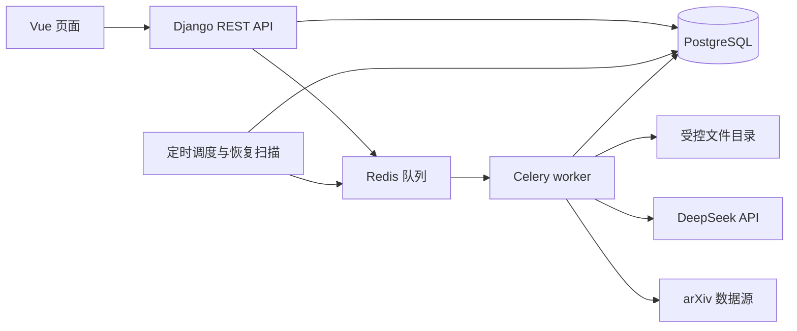
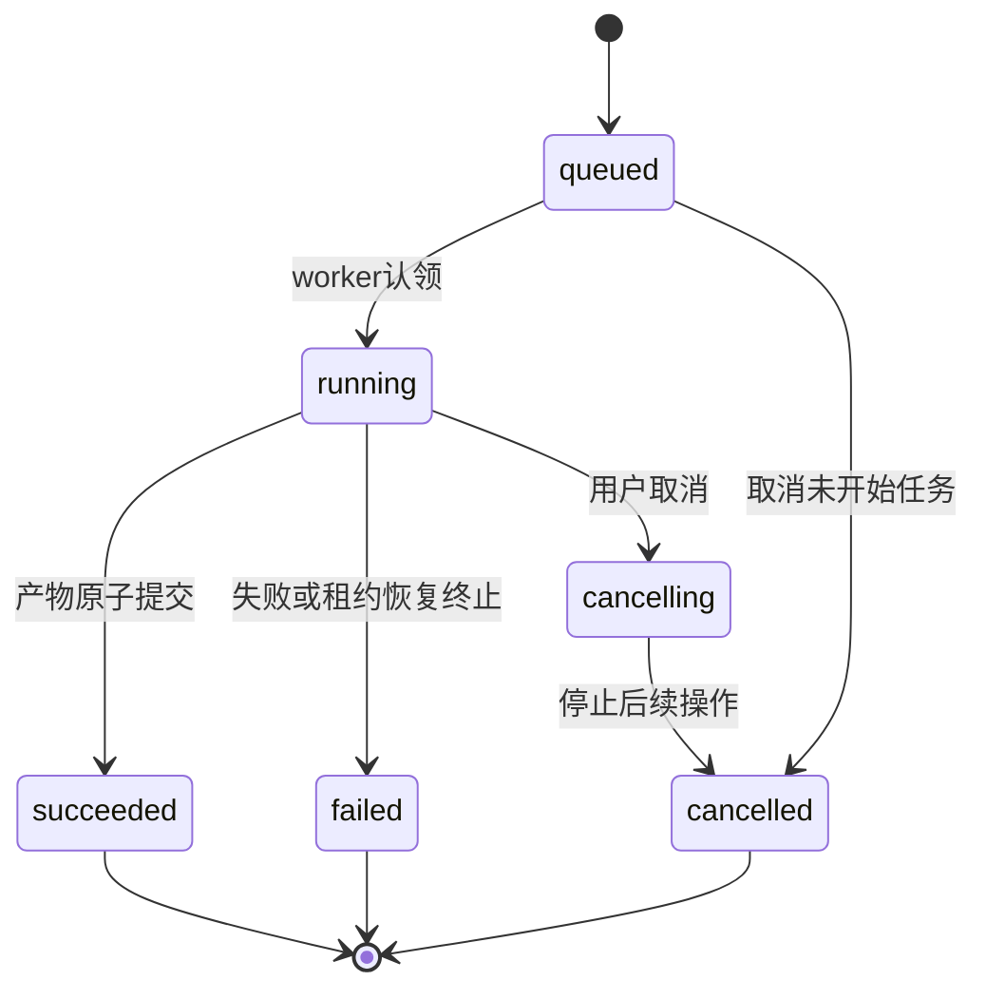

# 后台流程与 DeepSeek 规范

版本：1.0｜日期：2026-09-19。本文规定内部模块合作方式，不是应用实现代码。

## 1. 运行单元与依赖

- API 只做认证、参数校验、短事务和受理；耗时分析与模型调用均在 worker。
- `api.py → services.py → 专用解析 / 算法 / llm 模块`；API 层不直接访问供应商。数据模型只承担持久化约束，不能在 model.save 内调用外部 API。
- `jobs.tasks` 根据固定 kind 表分发到业务执行函数，禁止客户端传任意函数名。通用 jobs 服务不反向 import 所有业务模块。
- `llm` 只负责请求和输出验证，不自行修改 Review/Run；业务模块校验语义与归属后提交结果。
- 内部复用函数直接返回数据。生成章节时调用内部 `retrieve_evidence`，不再提交嵌套 retrieve Job，否则会与项目单活跃任务约束冲突。

## 2. 内部接口约定

以下为函数签名设计；实现文件归属见 01，输入输出类型可用 Python 类型定义和数据类表达。

| 模块 / 入口 | 输入 | 输出 / 副作用 |
| --- | --- | --- |
| projects.services.create_project / update_project | actor_id、已校验字段、expected_version | Project；锁版本，问题变化递增 corpus_revision |
| literature.services.upload_pdf | actor_id、project_id、文件流、metadata、幂等键 | Paper；文件先暂存校验，事务登记，重复哈希复用 |
| literature.services.import_arxiv / execute_import_arxiv | 受理：actor、project_id、arxiv_ids、key；执行：context、import_batch_id（首次 Job ID） | 受理返回 Job；执行保存逐项账本，仅成功文件创建 Paper |
| analysis.services.create_run | actor_id、project_id、幂等键 | 事务内冻结 Run/RunPaper、创建 analyze Job |
| analysis.services.execute_run | context、run_id | 逐阶段保存；最终 ready 或 failed/cancelled |
| parsing.services.parse_paper | context、paper_snapshot、parser_config | ParsedDocument 与 EvidenceChunk；仅复用完全成功且键一致产物 |
| retrieval.services.retrieve_evidence | run_id、query、candidate_limit、top_k、ExecutionContext | 证据 hit 列表；内部函数不创建 Job |
| retrieval.services.create_retrieval / execute_retrieval | actor / run / 请求；或 context、retrieval_id | 预建资源与 Job；执行后填入 results |
| reviews.services.create_review | actor_id、run_id、生成配置、幂等键 | Review 无正文 + generate_review Job |
| reviews.services.generate_review | context、review_id | 合法五节正文一次性提交 revision 1 |
| reviews.services.save_revision | actor_id、review_id、base_revision_number、sections | 新不可变 revision；不触发模型调用 |
| reviews.services.validate_revision | context、validation_id | 针对固定正文版本的 ValidationReport |
| reviews.services.export_revision | context、export_id | 临时 DOCX → 完成后原子发布文件与 Export.ready |
| jobs.services.accept_job / cancel_job / retry_job | actor、项目、资源、冻结输入、key | 统一幂等、并发、取消或新尝试 |
| jobs.tasks.execute_job | job_id | 认领租约，调用固定分发器，统一终态处理 |
| llm.client.call_structured | context、ModelTaskRequest | ModelTaskResult 或类型化错误，记 ModelCall |

`ExecutionContext` 至少含 job_id、project_id、run_id（可空）、attempt、lease_token、deadline、cancel_checker。模型请求输入包含 task_type、template_version、schema_version、model_config、payload、allowed_evidence_ids、allowed_paper_ids。返回包含 payload、provider_request_id、usage、finish_status、call_id；不返回私钥。

跨模块返回显式结构，禁止传 Django request 对象、隐式读当前用户、以全局变量保存当前项目。对其他 app 的业务写入走其 service，避免直接改其表状态。

## 3. 分析流水线

| stage | 输入 | 操作 | 提交产物与恢复点 |
| --- | --- | --- | --- |
| snapshot | 当前项目与纳入论文 | 冻结研究问题、元数据、哈希、配置及模板版本 | Run + RunPaper；之后只读快照 |
| parse | 单篇 PDF | 文本提取、复杂页渲染与辅助识别、片段切分 | 完整 ParsedDocument + Chunks；不发布半成品 |
| extract | 单篇证据 | DeepSeek 要素与单篇摘要，原文引用检查 | PaperAnalysis + RunPaper.ready |
| index | 本 Run 可用片段 | 建词频索引与 evidence_id 行号映射 | Run 专属索引文件与 manifest |
| topics | 全部单篇结果 | 分批主题归纳、合并与成员映射 | Topic 列表；允许未归类论文 |
| disputes | 同主题论文候选 | 研究条件对齐、结论比较 | Dispute 候选，人工状态 pending |
| finalize | 全部阶段结果 | 按冻结年份计算统计、检查覆盖 | Run.ready 与 Job.succeeded 同一事务 |

各论文 parse/extract 可依次进行。任一纳入论文失败，记录原因并结束 Run.failed，不进入完整主题 / 综述流程。没有争议候选或某主题只有少数文献是合法结果，不要求模型凑数。

parse 页级中间文件可暂存，但只有全部页完成才发布 ParsedDocument；失败页面保留诊断。遇到无法解析的页，用户可重试或排除整篇再新建 Run，不能未经告知忽略缺页。

索引 manifest 包含 run_id、corpus_revision、解析产物 ID 与哈希、词表配置、依赖版本。索引文件只能由应用生成读取，不能接收用户上传的 pickle/joblib 对象。

## 4. 引用链与模型内容的边界

1. 文本型 PDF 原文与模型整理文本分别保存。字词归一化规则版本化；引文必须在同页原文中匹配，不能只在模型改写文本中自我证明。
2. 图片识别产物绑定后端真实页码、渲染图像、裁剪坐标；默认 verification=image_unverified。MVP 没有“人工认证证据”接口，human_verified 是保留枚举，应用不得自动设置。
3. chunk 至少有 text、element_type、page_number、section、真实来源；模型只能引用已给出的 chunk ID。页码和 paper_id 由服务端填充。
4. PaperAnalysis 的 research_question、research_object、summary 使用 `{value,evidence_ids}`，没有信息时 value=null 且 evidence_ids=[]；methods/datasets/metrics/conclusions/limitations 是该结构的数组，无条目时用 []。有事实性内容必须提供同篇证据。
5. 主题的成员文献、争议两侧、重排结果和生成引用均须属于当前 Run。争议左、右论文必须不同，证据分别来自对应论文。
6. 未人工确认的 possible_conflict 只能写成“候选分歧、待核对”，rejected 候选不进入争议结论；confirmed 表示用户认可分类，不能推断“双方必有一方错误”。
7. 没有真实引用指标时，不生成被引次数、期刊等级、作者影响力或质量分数。年份缺失进入 unknown_year_count。
8. 缺乏证据的章节输出明确的覆盖限制，可用 transition 说明“本轮证据不足以形成判断”，不能编造陈述满足篇幅。

## 5. 生成、编辑、验证、导出

### 5.1 生成

`freeze_inputs → retrieve_sections → generate_sections → check_structure → commit_revision`。

- 固定五节，逐节构造问题和证据包；每节最多 20 个候选重排，再选 5—10 个证据作为初始生成上下文，实际参数保存在任务快照。
- 每节输入包含真实题录、单篇要素、主题、已复核 / 未复核争议标签、该语料年份统计与 evidence ID。
- DeepSeek 返回 block 的 kind/text/evidence_ids；block_id 由后端分配。生成模板不允许 HTML、虚构参考文献编号和外部“记忆中的论文”。
- 全部五节的结构、引用范围和 block 数限制通过后，一次性创建 revision 1；部分章节只存在任务中间产物，失败不暴露为完整正文。
- 生成时记录语料版本、analysis_revision、模板和模型配置。取消或旧 worker 的迟到响应不得覆盖新结果。

### 5.2 保存与核验

保存是同步短事务，比较 base_revision_number 后全量存新版本。继承原 analysis_revision，用户改字不能自动消除来源过时状态。

核验流程：`load_revision → check_structure → verify_blocks → commit_report`。

结构检查覆盖节序、唯一 block ID、claim 引用非空、片段存在且属于 Run、来源可读取。结构失败报告为 needs_review / structure_passed=false，禁止导出。

语义检查按 block 比对原文，返回 supported/unsupported/uncertain/not_applicable，关注数字、否定、比较对象和适用条件。任何未支持或不确定项导致 needs_review。同一模型辅助核验不能替代人工标注评测；模型自报“高置信度”不作为验收依据。

核验请求本身失败时 Job.failed，报告结果保持 null，不能伪装为 needs_review 已完成。成功报告必须覆盖每个 block 恰好一次；有事实的 transition 不能用 not_applicable 绕过检查。

### 5.3 导出

在受理时验证 revision 与 validation 的关联、完成状态、结构结果及警示确认；冻结这些输入，执行时再核对完整性。只用冻结元数据排参考文献，按首次引用去重编号。正文、参考文献、页级证据附表、AI 草稿标识及未解决问题一并输出。

文件写入临时路径并完整关闭、检查可打开后，再改为正式路径并登记 FileAsset。失败文件不对外可见；导出重试可清理本任务自己的临时文件，不能删除别的任务产物。

## 6. DeepSeek 请求规范

首期统一使用 `POST {DEEPSEEK_BASE_URL}/responses`；由后端传认证密钥。基线服务地址为官方 `https://api.deepseek.com`。不把供应商参数开放成任意客户端 JSON。

| 项 | 约定 |
| --- | --- |
| model | 来自 DEEPSEEK_MODEL，首测 deepseek-flash；图片任务需核实该型号支持 |
| instructions | 系统任务、证据使用规则、允许字段与缺失策略 |
| input | 明确标记的资料区；PDF 先转文本或图像，不直接传通用文件 |
| text.format | 优先 JSON Schema；从项目模型输出契约生成受支持的子集 |
| reasoning | 每种任务显式配置；不依赖供应商默认值 |
| max_output_tokens | 每任务预算内设置；思考额度计入输出，不能只给最终正文留额度 |
| stream | MVP 模型请求可关闭；前端轮询业务任务 |

官方参考：[Responses 参数](https://api-docs.deepseek.com/api/create-response/)、[兼容范围](https://api-docs.deepseek.com/guides/responses_api/)、[模型说明](https://api-docs.deepseek.com/quick_start/pricing/)。官方字段支持可能变化，首次接入要用账户完成文本、图片、结构化输出三类冒烟；不通过时明确报接入问题，不自行切换供应商。

### 6.1 模型任务与输入输出

配套 [contracts/model_outputs.schema.json](contracts/model_outputs.schema.json) 定义业务结果 Schema；各 `$defs` 独立使用，不能直接把含全部定义的总文件当成每次请求的 schema。供应商如不支持某个 JSON Schema 关键字，客户端仍按完整业务 Schema 校验，记录采用的接口兼容配置。

| task_type | 输入 | 结构化输出类型 | 必须再做的业务验证 |
| --- | --- | --- | --- |
| page_extract | 单页文本或图像、真实页号 | PageExtract | 元素原文或图像回查；不能由模型改页号 |
| paper_extract | 单篇带 ID 的片段 | PaperExtract | 字段证据同篇、缺失用 null |
| query_expand | 原问题与领域 | QueryExpand | 扩展最多 5 项；保留原问题 |
| rerank | 查询、候选 ID 与原文 | Rerank | 返回 ID 在候选中、不得重复、按相关性排序 |
| topics | 文献 ID 与要素 | Topics | 成员 ID、未归类覆盖、标签依据 |
| disputes | 同主题可比较论文与证据 | Disputes | 两侧不同论文、证据对应、条件完整 |
| review_section | section_key、证据与分析 | ReviewSection | 单论断 block、引用合法；应用分配 UUID |
| verify_blocks | block 与其引用原文 | VerifyBlocks | block ID 完整且唯一、检查内容覆盖 |

模型响应先检查请求成功和完整结束，再读取 JSON、Schema 校验、业务引用校验。所有层通过才是有效结果。未知 ID、空响应、截断或非法 JSON 均作为 MODEL_OUTPUT_INVALID；最多一次带错误信息的修复请求，计入总尝试与费用。

### 6.2 默认限制（可配置，首次样本测试校准）

- 模型请求总超时 120 秒，单逻辑调用最多 3 次网络尝试，包含一次格式修复在内；指数退避并加随机扰动，尊重 Retry-After。
- HTTP 鉴权错误、无效参数、余额不足不自动重复；超时、暂时性限流 / 服务故障有限重试。图片或长输出超限需重新分批，不原样无限重发。
- 初始每次最多 2 张页面图像、每张不超过 5 MiB；图像缩放不能损害关键文字，不能满足可读性时分区域或报错。此为项目限制，不是对供应商上限的声明。
- 文字按章节 / 证据包控制，每次初始输入预算 24,000 token、输出预算 4,096 token；思考输出受此限制时应调小任务或调整已批准预算，禁止静默截断。
- 本地切片器保留章节、真实页码及相邻上下文；MVP 先试每片 600—1,200 中文字符或等价英文长度，跨页段落拆分并显式关联，不伪造单页坐标。

## 7. 费用、缓存与日志

- `.env` 提供密钥、默认项目预算和输入命中缓存 / 未命中缓存 / 输出计价。价格与预算未配置时只允许模拟模式，真实模型调用被阻止；配置不等于本次已获得任何消费额度。
- USD 使用定点十进制；预留按保守输入上界、输出上界和当时单价估算，缓存折扣在 usage 返回后结算，不事先承诺命中。
- 发出请求前在数据库锁住项目 UsageBudget，检查已花费 + 已预留 + 本次上界；部署级并发限制同样在共享协调中生效，不能每个 worker 各自算 2 个。
- usage 的推理 token 是输出的一部分，不能再次累加计费。输入缓存命中与未命中按供应商字段拆分；计价规则随模型快照记录。
- 网络超时可能已经计费。费用无法确认的 ModelCall 标为 unsettled，保留预留，不立即释放并再次用掉；管理员核对账单后处理。应用只能降低超支风险，不能承诺供应商账单的绝对硬上限。
- 缓存键至少含 project_id、task_type、规范化输入哈希、证据 / 解析版本、model、模板版本、Schema 版本和思考参数。命中缓存保留原 call_id，不能重复记供应商费用。
- 持久日志只记录 task/model/request_id/耗时/usage/错误摘要；不记录密钥。需要保存模型业务原始输出时放受权限控制的文件，并关联 ModelCall，不输出到浏览器控制台。

## 8. 任务状态、重试与恢复

终态不回退。retry 只接受业务资源最新且未成功的尝试，创建新 Job，沿用同一业务资源与冻结输入，并链接 retry_of_job_id；Run / Export 等可进入新尝试对应状态，旧 Job 历史保持不变。导出重试重新校验警示，新增未确认警示时拒绝重试，要求新建并确认 Export。

### 8.1 受理与队列一致性

1. 事务内锁 Project，优先查幂等记录；检查权限、版本和活跃任务唯一约束。
2. 创建业务资源、Job.queued 和幂等响应，提交事务后通知队列。
3. 提交成功但投递失败时，保留 queued。定时扫描器补投没有有效派发记录或派发超时的 queued Job；重复投递允许，重复执行不允许。
4. worker 通过数据库条件更新认领 Job 与 lease_token，只处理当前有效尝试。队列 ACK 不能作为成功凭据。

### 8.2 租约与迟到响应

- 长任务定期续租，建议每 10 秒心跳、60 秒租约；网络请求等待期间也需续租，不能把正常 120 秒模型调用误判死亡。
- worker 每次提交阶段产物、预算结算与终态时验证 lease_token。租约失效的 worker 可记录迟到计費线索，但不能覆盖当前任务业务产物。
- 恢复扫描对过期租约先撤销旧 token，记录 WORKER_LOST；running 进入 failed，cancelling 进入 cancelled。释放项目活跃锁之前，保留仍可能在执行的外部请求为 unsettled。
- 重试只复用已完整提交且缓存键一致的产物；旧 worker 的未提交结果丢弃。生成正文使用唯一约束避免重复 revision 1。
- 取消先检查状态，再写取消请求；若成功提交已先完成则保持 succeeded。若先取得取消标志，则 worker 只做必要记账与清理，不能再发布正文或导出。

### 8.3 原型故障演练

至少实际验证：提交后 Redis 不可用、worker 处理中断、供应商超时、返回坏 JSON、同 key 重放、两个浏览器同时发起任务、取消与完成竞争、旧租约迟到、编辑后使用旧报告导出。验收证据格式见 05。

## 9. 前端状态与协作

- 项目页以 active_job_id 禁用互斥写操作；即便前端禁用，后端仍要做事务校验。
- 切换路由销毁轮询，回到页面从 Project / 资源获取 Job；用户退出停止所有轮询并清空私有缓存。
- 请求失败保留输入与幂等 key；结果已存在时显示原结果。正文编辑遇 409 不自动重试覆盖，先显示远端版本与未保存内容。
- 页面并列展示纳入、成功、失败数；stale、image_unverified、needs_review 都有可理解提示。
- 点击引用先 GET evidence，再打开该证据的原始 PDF 页面。旧草稿使用旧 Run 证据，不重新映射到新解析结果。
- 人工新增引用通过 `/runs/{run_id}/papers/{paper_id}/evidence` 分页或按页选取；旧 Run 可读，用户无需猜 ID。历史页面采用 Run 冻结的研究问题和输出语言。
- 导入执行先初始化逐项 pending；每个无版本 arXiv ID 解析后先保存 resolved_source_id 再下载。重试从上一尝试复制账本，只补 pending/failed，已解析版本保持不变；取消前未执行的项目不丢失。
